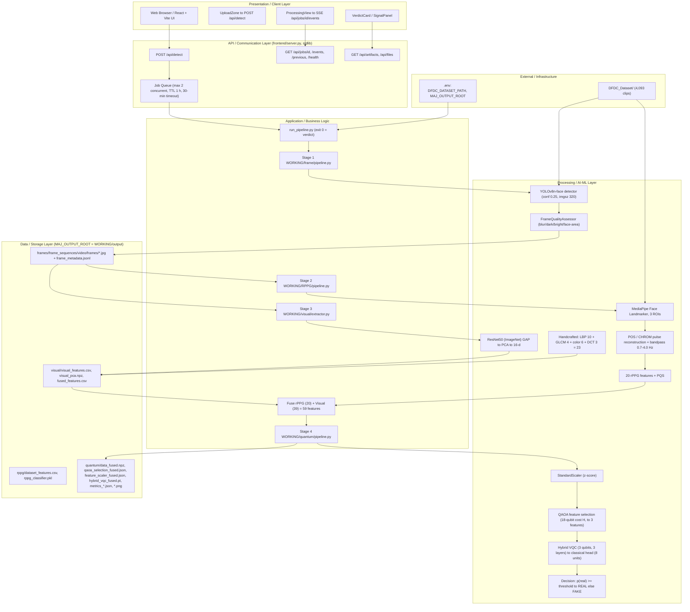

# PROJECT_RESEARCH_REPORT

## Evidence-Based Research Audit of the Deepfake Video Detection for KYC Project

| Item | Value |
|---|---|
| Report generated | 2026-10-11 (audit session) |
| Repository root | `C:\Users\JHASHANK\Desktop\Maj_Proj` |
| Audit method | Read-only inspection of source code, configuration, generated artifacts, logs, and existing documentation |
| Reproduction status | **No experiment was executed for this report.** All metrics below are read directly from existing artifacts and are labelled *reported (artifact-read), not independently reproduced*. |
| Status vocabulary | **Verified** - directly confirmed in inspected files. **Partially Verified** - some elements confirmed, others missing or unconfirmed. **Unverified** - claim exists but no supporting artifact could be checked. **Not Available** - no supporting evidence exists in the inspected project files. |

> **Global caveat that governs every results section (Sections 11-15):** the trained artifacts currently on disk were produced by a **38-video smoke run** executed on **2026-10-11 23:06-23:09 IST** (file timestamps under `WORKING/output/`), corresponding to the `changes.md` entry *"2026-10-11 23:10 IST ... -Quick smoke run completed end-to-end (38 videos, fused 59 features, quantum VQC trained+evaluated)."* They are **not** results over the full 4,093-video dataset present on disk. All metrics therefore have a test set of **n = 8 clips** and are statistically indicative only.

---

## 1. Final Project Title and Research Objective

**Findings**

- Project title (repository root `README.md`, line 1): **"Deepfake Video Detection for KYC (rPPG + Visual + Quantum ML)"**.
- Research objective as stated in `README.md:5-8`: detection of deepfake videos for **video KYC in financial systems** using (a) **rPPG** (remote photoplethysmography) as the physiological evidence layer, (b) **visual features** (ResNet50 + handcrafted descriptors) as the complementary appearance layer, and (c) **hybrid quantum-classical machine learning** as the final decision layer, **designed for low-resolution videos**.
- The system produces exactly two decision outcomes, `REAL` and `FAKE` (`AGENTS.md`, "Supported Architecture"; enforced by `WORKING/quantum/explain.py` and `WORKING/run_pipeline.py`). Multi-state outcomes were removed on 2026-10-11 (`changes.md`, 17:30 IST entry).
- Python project metadata: `pyproject.toml` name `deepfake-rppg`, version `1.0.0`, description *"Deepfake detection using rPPG + hybrid quantum ML"*.
- Scope restrictions declared by the project itself: **fused feature mode only** and **DFDC dataset only** (`README.md:32-33`, `AGENTS.md` "Supported Architecture"; enforced by `WORKING/quantum/config.py:137-139`, where `FEATURE_SET_CONFIGS` contains only `"fused"`).

**Evidence**

- `README.md:1-8, 32-33`
- `AGENTS.md` (Supported Architecture section)
- `pyproject.toml:1-5`
- `WORKING/quantum/config.py:133-145`
- `changes.md` (2026-10-11 17:30 IST entry)

**Status:** Verified

**Action Required:** None.

---

## 2. Complete System Architecture Diagram

**Findings**

The system is a **four-stage pipeline** with a web front end, a standard-library API server, and a storage layer:

```
Input KYC video
  -> Stage 1: Frame sampling + quality filtering    (WORKING/frame/)
  -> Stage 2: rPPG signal extraction + features     (WORKING/RPPG/)
  -> Stage 3: Visual feature extraction             (WORKING/visual/)
  -> Stage 4: QAOA selection -> hybrid VQC verdict  (WORKING/quantum/)
  -> Decision: REAL / FAKE
```

(`README.md:17-30`; orchestration implemented in `WORKING/run_pipeline.py`.)

A complete, already-existing Mermaid system architecture diagram covering all six layers (Client, API, App Logic, ML, Storage, External; 64 nodes, 93 edges) is stored at **`architecture.mmd`** (project root, 239 lines). Its structure was verified line-by-line during this audit and the condensed diagram below is derived strictly from it and from code - no invented components.



**Evidence**

- `architecture.mmd:1-239` (existing, complete diagram; `changes.md` 2026-10-02 15:30 IST records its creation: 6 layers, 64 nodes, 93 edges)
- `README.md:10-30, 35-53, 212-226` (API contract, repository layout)
- `frontend/server.py` (endpoints, job queue, 30-min `JOB_RUN_TIMEOUT_SECONDS`)
- `WORKING/run_pipeline.py:6-18, 102, 317, 385-390`

**Status:** Verified

**Action Required:** None. (A rendered PNG of `architecture.mmd` is referenced in `changes.md` as `Scrape/architecture.png`; that file is gitignored scratch output and was **not** present during this audit.)

---

## 3. Detailed Data Preprocessing Pipeline

**Findings**

**Stage 1 - Frame sampling and quality filtering (`WORKING/frame/`)**

| Parameter | Value | Evidence |
|---|---|---|
| Sampling rate | `run_pipeline.py` uses **30.0 fps**; standalone CLI default 10.0 fps | `run_pipeline.py:102`; `frame/pipeline.py:60,440` |
| Face detector | YOLOv8n-face (lindevs weights), conf **0.25**, `imgsz` **320** | `frame/pipeline.py:24-29,63-66,70-71` |
| Blur threshold (Variance of Laplacian) | **3.0** (relaxed for compressed video) | `frame/pipeline.py:75` |
| Dark / bright thresholds | **30.0 / 235.0** | `frame/pipeline.py:76-77` |
| Minimum face-area ratio | **0.002** | `frame/pipeline.py:78-82` |
| Minimum sequence length | **32** frames | `frame/pipeline.py:61` |
| rPPG readiness gate | avg face >= 48x48 px, colour variation std > 0.5 | `frame/pipeline.py:383-385` |
| Output | accepted JPEGs (OpenCV default quality, native resolution, **no resize**) + `frame_metadata.jsonl` | `frame/pipeline.py:343` |

**Stage 2 - rPPG (`WORKING/RPPG/`)**

- Face ROIs via **MediaPipe Face Landmarker** (bundled `face_landmarker.task`, 3,758,596 B): left cheek, right cheek, forehead (`RPPG/face_roi.py`).
- Pulse reconstruction: **POS** (default) and **CHROM** methods (`RPPG/signal_extraction.py:10-17,45-56`); CLI `--method POS`.
- Cleaning chain: interpolate -> **Tarvainen detrend (lambda = 300)** -> **zero-phase Butterworth band-pass 0.7-4.0 Hz (order 4, adaptively reduced to 3/2 for short signals)** -> z-score (`RPPG/preprocessing.py:34,72-144`).
- Analysis window: `window_duration_sec = 8.0` s (`RPPG/pipeline.py:137`).
- Dataset-extraction gates: `--min-usable-frames 24`, blur 3.0, brightness 15-245, `min_sqi` **0.05** (code default), non-finite rejection (`RPPG/extract_dataset_features.py:361-375,678`; `RPPG/pipeline.py:131` also defaults to 0.05). Note: `WORKING/RPPG/README.md:129` still documents 0.10 - stale doc; code is authoritative.
- Output: **20-feature** physiological vector persisted with label (`1 = fake`, `0 = real`) in `MAJ_OUTPUT_ROOT/rppg/dataset_features.csv`.
- Physiological plausibility filter at quantum build time: HR 30-220 BPM, non-finite rejection (`quantum/config.py:225-227`, `quantum/data.py`).

**Stage 3 - Visual (`WORKING/visual/`)**

- **ResNet50** (ImageNet weights) -> global-average-pool 2048-d -> **PCA to 16 dims**, input **224x224**, ImageNet normalisation; PCA is a training-only artifact `visual_pca.npz` (leakage-safe: per-video crops are averaged before PCA transform) (`visual/extractor.py:21-51,148,182-184,278-347,425-426`).
- Handcrafted: **LBP uniform (r=1, 8 points) -> 10 bins**; **GLCM (32 levels, symmetric, normalised) -> 4**; **RGB mean/std -> 6**; **DCT on 64x64 grayscale -> 3** band energies (`visual/extractor.py:349-387`).
- Sampling: `--max-frames 100`, effective **10 fps** stride over accepted frames (`visual/pipeline.py:187-188,446,475-476`).
- Total **39 visual features**; fused with 20 rPPG features = **59-feature contract** (`quantum/config.py:84-139`).

**Stage 4 - Quantum preprocessing (`WORKING/quantum/`)**

- Explicit label conversion `y = 1 - csv_label` **only** inside `csv_to_quantum_label()` (`quantum/data.py:43-61`; constants at `:34-35`).
- z-score standardisation via fitted `feature_scaler_fused.json`; clip-grouped seeded split persisted to `split_manifest_fused.json`.

**Evidence:** files/lines cited in each row above; artifact column counts confirmed by direct read of `dataset_features.csv` (20 feature columns + `label`, `video_path`, `source`) and `fused_features.csv` (59 feature columns + metadata).

**Status:** Verified (as implemented). **Not reproduced** end-to-end during this audit.

**Action Required:** None for the pipeline description. A full-dataset preprocessing run is required only for Sections 11-15 metric regeneration (see Section 11).

---

## 4. Dataset Names, Sources, Sizes, and Class Distributions

**Findings**

| Item | Value | How established |
|---|---|---|
| Dataset name | **DFDC** (Deepfake Detection Challenge dataset), stored locally as `DFDC_Dataset/` | `AGENTS.md`; `README.md:106`; `DFDC_DATASET_PATH=C:\Users\JHASHANK\Desktop\Maj_Proj\DFDC_Dataset` in `.env` |
| On-disk layout | Flat two-class reorganisation: `DFDC_Dataset/Fake/` and `DFDC_Dataset/Real/` (no upstream DFDC part structure) | Directory listing |
| Total clips on disk | **4,093 video files** | Directory count (2,127 + 1,966) |
| Class distribution on disk | **Real 2,127 (51.97%) / Fake 1,966 (48.03%)** | Directory count |
| Total size on disk | **2.17 GB** | Recursive size sum |
| Clips used in current training artifacts | **38** (after 40 attempted, 2 failed with no features) | `WORKING/output/rppg/checkpoint.json` (`processed_count: 38`, `no_features_count: 2`); `extract_stderr.log` final line |
| Feature-table class balance | **label 1 (fake) = 20, label 0 (real) = 18** | Direct read of `WORKING/output/visual/fused_features.csv` |
| Failed extractions | `pcemgkfqgn.mp4`, `bfdopzvxbi.mp4` -> `-> Failed to extract features` | `WORKING/output/rppg/extract_stderr.log` |
| Alternate/auxiliary data | Root `test1.mp4` (19.4 MB) is a single test video, not a dataset | Directory listing |

**Evidence:** `.env:1`; `WORKING/output/rppg/checkpoint.json`; `WORKING/output/rppg/extract_stderr.log`; `WORKING/output/rppg/rppg_classifier_metadata.json` (`training_samples: 38`).

**Inconsistency identified:** the local `DFDC_Dataset/` is a re-packaged two-folder copy; the repository contains **no manifest, README, or licence file** documenting its provenance, which upstream DFDC parts it derives from, or how the Real/Fake split was constructed.

**Status:** Partially Verified - sizes and class counts verified by direct filesystem measurement; provenance, upstream part composition, and official statistics are **Not Available in the inspected project files**.

**Action Required:** Supply the DFDC provenance/licence record (official dataset README or download manifest) and confirm whether all 4,093 clips are unique, non-duplicated upstream DFDC videos.

---

## 5. Training, Validation, and Testing Split

**Findings**

- Configuration: `seed = 42`, `val_ratio = 0.2`, `test_ratio = 0.2` (`WORKING/quantum/config.py:220-231`).
- Split strategy: **clip-grouped, metadata-aware grouped split** with duplicate/leakage validation; grouping columns `subject_id, identity_id, original_video_id, source_video_id, source_id, group_id, video_sha256, content_sha256, file_sha256, sha256`, falling back to `clip:<path>` when no correlation metadata exists (`split_manifest_fused.json` -> `grouping.strategy = "metadata-first-grouped-split"`; implemented in `WORKING/quantum/data.py`).
- Persisted split (verified by counting `split_manifest_fused.json` entries):

| Split | Clips | Fake | Real |
|---|---|---|---|
| Train | 22 | 12 | 10 |
| Validation | 8 | 4 | 4 |
| Test | 8 | 4 | 4 |
| **Total** | **38** | **20** | **18** |

- The same seed/ratios are mirrored in the visual stage (`WORKING/output/visual/experiments/split_manifest.json`).
- 5-fold **StratifiedKFold** cross-validation is additionally reported for the VQC and every baseline (`quantum/evaluation.py`; `cv.folds` arrays in `metrics_quantum.json` / `metrics_baselines.json`).

**Evidence:** `WORKING/quantum/config.py:220-231`; `WORKING/output/quantum/split_manifest_fused.json`; `WORKING/output/visual/experiments/split_manifest.json`; `WORKING/output/quantum/metrics_quantum.json` (`cv.folds`).

**Status:** Verified

**Action Required:** None for the mechanism. Re-running the split over the full 4,093-clip set will change all downstream metrics (see Section 11).

---

## 6. Low-Resolution and Video-Compression Settings

**Findings**

The project claims low-resolution/compressed-video robustness as a design goal, but the implementation expresses this **only through relaxed thresholds and code-level defensiveness** - not through controlled low-resolution or compression experiment settings.

| Setting | Value | Location |
|---|---|---|
| Blur threshold (frame gate) | 3.0, comment *"lowered for compressed video"* | `frame/pipeline.py:75` |
| Detection confidence | 0.25, comment *"lowered for low-quality"* | `frame/pipeline.py:70` |
| Detector input size | `imgsz = 320` (small-input face detection) | `frame/pipeline.py:71` |
| Dark / bright gates | 30.0 / 235.0 | `frame/pipeline.py:76-77` |
| rPPG blur threshold | 3.0 *"for low-res compressed video"* | `RPPG/pipeline.py:150`, `RPPG/extract_dataset_features.py:671` |
| Minimum ROI size | reduced **10 -> 3** px | `RPPG/face_roi.py:175` |
| Skin mask | disabled on low-resolution frames; wider Cr/Cb skin range | `RPPG/face_roi.py:375,388,408,461,552` |
| Band-pass order | adaptively reduced for short/noisy signals; comment *"adjust cutoffs for compression noise"* | `RPPG/preprocessing.py:85,98-103` |
| Frame output | native resolution, **no downscaling**, OpenCV default JPEG quality | `frame/pipeline.py:343` (absence of `cv2.resize`/`IMWRITE_JPEG_QUALITY` verified by repo-wide grep) |

**Explicit negative findings**

- **No resolution-degradation harness** (no code re-encodes videos at controlled resolutions).
- **No compression/bitrate/quality-factor sweep harness** (no re-encoding at controlled bitrates or CRF values; repo-wide grep for compression/bitrate/experiment runners returned only the threshold comments above).
- No artefacts containing results stratified by resolution or compression level.

**Evidence:** file:line citations above; negative findings from repo-wide keyword search over `WORKING/`, `frontend/`, `tests/`.

**Status:** Partially Verified - defensive settings are Verified; **measured** low-resolution/compression robustness results are **Not Available in the inspected project files**.

**Action Required:** To support the low-resolution/compression claim empirically, a controlled degradation harness (e.g. re-encode the DFDC clips at defined resolutions/bitrates) plus a results table must be created and executed. This report does **not** assert any such results.

---

## 7. CNN, ViT, rPPG, and Quantum Module Specifications

**Findings**

| Module | Specification | Status of claim |
|---|---|---|
| **CNN (visual deep branch)** | **ResNet50**, ImageNet-pretrained, penultimate global-average-pool -> 2048-d -> **PCA -> 16 dims** (`deep_feat_0..15`), input 224x224, ImageNet mean/std normalisation | **Verified** - `visual/extractor.py:29-51,148,182-184` |
| **Handcrafted visual branch** | LBP-uniform 10 + GLCM 4 + colour 6 + DCT 3 = **23**, total visual = **39** | **Verified** - `visual/extractor.py:349-387`; contract test `tests/visual` asserts equality with `quantum.config.VISUAL_FEATURE_NAMES` |
| **ViT (Vision Transformer)** | **No ViT module exists anywhere in the codebase.** A case-insensitive search for `vit`, `timm`, `transformer`, `VisionTransformer` across `WORKING/**/*.py` matched only the unrelated word "sensitivity" in `quantum/evaluation.py` | **Not Available in the inspected project files** - the question's ViT component is not implemented |
| **rPPG module** | MediaPipe Face Landmarker ROIs (3 regions) -> POS (default) / CHROM -> detrend lambda=300 + Butterworth 0.7-4.0 Hz -> **20 features** + Physiological Quality Score (PQS) | **Verified** - `RPPG/features.py:8-30`, `RPPG/signal_extraction.py:10-17`, `RPPG/preprocessing.py:34,72-144`, `RPPG/pqs.py:74-99` |
| **rPPG side classifier (cross-check)** | `Pipeline(SimpleImputer(median) + RandomForestClassifier(class_weight='balanced'))` over the 20 features; artifact trained on **38 samples (20 fake / 18 real)** | **Verified** - `RPPG/train_classifier.py:69-75`; `rppg_classifier_metadata.json` |
| **Quantum module** | QAOA selector + hybrid VQC over the fused **59-feature** vector (only 3 features ultimately enter the circuit) - detailed in Section 8 | **Verified** - `quantum/qaoa.py`, `quantum/vqc.py`, `quantum/config.py` |

**Evidence:** citations in the table; feature-contract test asserted by `python -m quantum.tests` (10/10 checks recorded in `changes.md` 2026-10-11 23:18 IST).

**Status:** Partially Verified - CNN, rPPG, and quantum specifications Verified; **ViT: Not Available (not implemented)**.

**Action Required:** If a ViT component is required for the final deliverable, it must be built and trained; it cannot be documented from this codebase as-is.

---

## 8. Quantum Circuit Configuration, Qubit Count, Gates, and Layers

**Findings**

**8.1 QAOA feature-selection circuit (`WORKING/quantum/qaoa.py`, `qaoa_sim.py`)**

| Parameter | Value | Evidence |
|---|---|---|
| QAOA depth `p_layers` | **3** | `quantum/config.py:236` |
| Optimizer | **COBYLA** (`scipy.optimize.minimize`), `max_iter = 500` | `quantum/config.py:237`; `qaoa.py:251,267` |
| Restarts | **8** parallel via `ProcessPoolExecutor`, seed 42 | `quantum/config.py:241-242`; artifact `restarts.n_restarts: 8` |
| Cost Hamiltonian | **Diagonal**, built from supervised discrimination weights (`2*|AUC-0.5|`, exact Mann-Whitney) + redundancy penalty 0.3 + cardinality penalty 0.5 | `quantum/config.py:238-239`; `README.md:132-135` |
| Qubit count | Classical AUC pre-selection to **k = 18** when features > 20 -> **18-qubit** cost Hamiltonian during search; inference circuit uses the **3** selected features | `quantum/pipeline.py:174-181`; `qaoa_sim.py` docstrings |
| Mixer gates | **X-mixer** implemented as `R_x(2*beta)` per qubit; cost gates applied with `gamma` | `qaoa_sim.py:14`; regression test `test_beta_alive` in `quantum/tests.py` |
| Parameter count | `2 * p_layers = 6` (gamma, beta pairs), initialised `U(0.0, 0.3)` | `qaoa.py:251,267` |
| Backend | Torch-native exact statevector simulator (`complex128`), PennyLane path retained behind `device="pennylane"` | `qaoa_sim.py`; `quantum/config.py:244-249` |
| Hamiltonian identical to classical cost | hard-asserted in `quantum/pipeline.py`, error < 1e-6 (documented as ~1e-14 on real data) | `README.md:155,256` |

**Artifact result (`qaoa_selection_fused.json`):** `selected_indices [7, 34, 22]` -> `left_right_cheek_correlation`, `deep_feat_14`, `deep_feat_2`; `cost = -2.6522895942946008`; `chosen_seed 46`; selection stability `mean_jaccard 1.0`.

**8.2 Hybrid VQC inference circuit (`WORKING/quantum/vqc.py`)**

| Parameter | Value | Evidence |
|---|---|---|
| **Qubit count** | **3** (one per QAOA-selected feature; `n_qubits = n_features`) | `vqc.py:314-318,370-387`; artifact selection size 3 |
| Encoding | **Angle embedding, rotation = "Y"** | `vqc.py:96` |
| Ansatz | **`StronglyEntanglingLayers`**, `qml_layers = 3` (3 repetitions), circular SWAP pattern `((l % (n_qubits-1)) + 1)` | `quantum/config.py:255`; `vqc.py:97,159-166` |
| Readout | **`PauliZ` expectation per qubit** (3 values) | `vqc.py:98` |
| Classical head | `Linear(3 -> 8)` + ReLU + **dropout 0.2** + output -> P(real) | `vqc.py:314-326`; `quantum/config.py:256-257` |
| Simulator | Default `QuantumLayerTorch` - exact torch-native statevector, `complex128`, batched; PennyLane `default.qubit` retained behind `qnode_impl="pennylane"` | `quantum/config.py:272-279`; `vqc.py:156-182` |
| Weight init | `0.1 * randn` | `vqc.py:156-168` |
| Checkpoints | `hybrid_vqc_fused.pt` + epoch snapshots 10/20/30/40, each with `.sha256` sidecar | `WORKING/output/quantum/` listing |

**Status:** Verified

**Action Required:** None. Note for reporting: with only **3 qubits**, claims of quantum advantage cannot be supported from this configuration; the report should describe it as a hybrid quantum-classical proof of concept (see Section 16).

---

## 9. Optimizer, Learning Rate, Batch Size, Epochs, and Loss Function

**Findings - configured vs. actually executed**

| Hyperparameter | Configured | Actually executed (from artifacts) |
|---|---|---|
| Optimizer | **AdamW** (`vqc.py:471`) | AdamW |
| Base learning rate | **5e-2** (`config.py:260`) | starts at 0.01667 (warmup) -> 0.05 -> cosine decay to **0.0204** at epoch 47 |
| LR schedule | `cosine_warmup`, `warmup_epochs = 3`, `weight_decay = 1e-2` (`config.py:261,265-267`) | confirmed in `training_log.jsonl` `lr` field |
| Batch size | **256** (`config.py:259`) | batch 256 (configured; not separately recorded per-epoch) |
| Epochs | **80** max (`config.py:258`) | **47 epochs run** (early stopping, `patience = 12`, `min_delta = 1e-4`) |
| Loss | **Class-balanced focal loss**, `alpha = 0.45`, `gamma = 1.0`, **label smoothing 0.03** (`config.py:262-264`; `vqc.py:339-351`) | train loss 0.1818 (ep 1) -> 0.0772 (ep 47) |
| Gradient clipping | `clip_grad = 1.0` (`config.py:270`) | applied (`vqc.py:539-541`) |
| Early stopping | restore best-**val_loss** checkpoint (`vqc.py:558-560,589-590`) | best checkpoint **epoch 34** (val_loss 0.1231); max val_accuracy **0.875** first reached at epoch 34 (held at 34-37 and 42-45; derived by scanning `training_log.jsonl`, 47 records) |
| Seed | 42 (`config.py:281`) | 42 |
| Decision threshold | Youden's J on validation, saved to checkpoint (`evaluation.py:286-291`, `pipeline.py:264-277`) | **0.506755530834198** (`metrics_quantum.json`) |

**Evidence:** `WORKING/quantum/config.py:253-284`; `WORKING/quantum/vqc.py:339-351,471,494-509,539-541,589-598`; `WORKING/output/quantum/training_log.jsonl` (47 records); `WORKING/output/quantum/metrics_quantum.json`.

**Defect identified (not fixed by this audit):** `quantum/pipeline.py:114` loads the tuned `opt_threshold` but `pipeline.py:117-121` builds a fresh `DecisionConfig()` whose `decision_threshold = 0.5`; therefore **live inference bins at 0.5**, while evaluation metrics were computed at 0.5068. Reported metrics and live decisions are therefore threshold-inconsistent.

**Status:** Verified (hyperparameters and training trajectory read directly from the training log).

**Action Required:** None to document them. Resolve the `opt_threshold` dead-code inconsistency before treating metrics and live verdicts as comparable.

---

## 10. Hardware and Software Environment

**Findings**

**Software (declared, pinned)**

| Component | Version | Evidence |
|---|---|---|
| Python | **3.11.9** (venv) | `venv\Scripts\python.exe --version` |
| PyTorch | **2.5.1+cu121** (CUDA 12.1) | `requirements.txt` |
| torchvision / torchaudio | 0.20.1+cu121 / 2.5.1+cu121 | `requirements.txt` |
| PennyLane / lightning | **0.44.1 / 0.44.1** | `requirements.txt` |
| ultralytics (YOLO) | 8.3.0 | `requirements.txt` |
| mediapipe | 1.0.1 | `requirements.txt` |
| numpy / scipy / scikit-learn | 1.26.4 / 1.17.1 / 1.9.0 | `requirements.txt` |
| opencv-python | >=4.8.0,<5.0.0 | `requirements.txt` |
| onnxruntime-gpu | 1.20.2 (YuNet CUDA) | `requirements.txt`; `changes.md` 2026-10-01 19:35 IST |
| xgboost / pandas / matplotlib | 3.2.0 / 3.0.5 / 3.11.1 | `requirements.txt` |
| Frontend | React 18.3.1, Vite 5.4.11, lucide-react, motion | `frontend/package.json` |
| OS | Microsoft Windows 11 Home Single Language 10.0.26200 | `Win32_OperatingSystem` query |

**Hardware (observed on the current host, at audit time)**

| Component | Value |
|---|---|
| CPU | 13th Gen Intel Core **i5-13450HX**, 10 cores / 16 logical processors, base 2.4 GHz |
| RAM | **23.7 GB** physical |
| GPU | **NVIDIA GeForce RTX 4050 Laptop GPU** (driver 32.0.15.8186), plus Intel UHD Graphics |
| Python venv | `venv/` at repository root |

**Evidence:** `requirements.txt`, `pyproject.toml`, `frontend/package.json`; hardware via `Get-CimInstance Win32_Processor / Win32_ComputerSystem / Win32_OperatingSystem / Win32_VideoController`.

**Caveat:** no training-run metadata in the artifacts records the machine that produced them (no `nvidia-smi` snapshot, no CUDA availability flag, no host field in `metrics_*.json`). The hardware table above is the **current audit host**, assumed identical because artifacts were written locally on 2026-10-11 under this user profile.

**Status:** Software - Verified. Hardware - Partially Verified (current host measured; training host not recorded in artifacts).

**Action Required:** Record host/GPU/driver and library versions inside future training runs (e.g. a `run_metadata.json`) to make Section 10 independently reproducible.

---

## 11. Accuracy, Precision, Recall, F1-Score, AUC, and Confusion Matrix

**All numbers in this section are read from `WORKING/output/quantum/metrics_quantum.json` (test split, n = 8). They were NOT independently reproduced during this audit.**

**Findings - quantum model (smoke-run artifact, 2026-10-11 23:08)**

| Metric | Value |
|---|---|
| Accuracy | **0.500** |
| Precision | **0.500** |
| Recall (sensitivity) | **0.750** |
| Specificity (fake recall) | **0.250** |
| Balanced accuracy | **0.500** |
| F1 | **0.600** |
| AUC-ROC | **0.5625** |
| PR-AUC | 0.6679 |
| Brier score | 0.2465 |
| ECE (calibration error) | 0.1881 |
| False-acceptance rate (fake accepted as real) | **0.750** |
| False-rejection rate | 0.250 |
| Classified / total | 8 / 8 (coverage 1.0) |

**Confusion matrix (binary, rows = true, cols = predicted; `LABEL_REAL = 1`, `LABEL_FAKE = 0`):**

|  | Predicted REAL | Predicted FAKE |
|---|---|---|
| **True REAL** | 1 | 3 |
| **True FAKE** | 1 | 3 |

**Decision bins:** real 6 / fake 2 at decision threshold 0.506755530834198 (evaluation-time).

**5-fold cross-validation (VQC, mean +/- std over folds, each fold n ~ 4-5):**

| Metric | Mean | Std |
|---|---|---|
| Accuracy | 0.700 | 0.197 |
| AUC-ROC | 0.700 | 0.267 |
| Balanced accuracy | 0.667 | 0.230 |
| F1 | 0.467 | 0.400 |

**Consistency issue:** `README.md:55-63` ("Current Performance") reports Accuracy 0.552, Balanced Accuracy 0.499, AUC 0.535, and "Best Classical (LR) TBD" - these **do not match** the current artifacts (0.500 / 0.500 / 0.5625). The README table is stale relative to the on-disk metrics.

**Evidence:** `WORKING/output/quantum/metrics_quantum.json`; `WORKING/output/quantum/roc_curve.png`, `confusion_matrix.png`, `calibration_curve.png` (generated 2026-10-11 23:08:52); `README.md:55-65`.

**Status:** Partially Verified - numbers verified against their source JSON artifacts; **not reproduced** by a fresh run, and derived from n = 8 test clips only.

**Action Required:** Re-run `python -m quantum.pipeline --all` from `WORKING/` after a **full-dataset** preprocessing pass to obtain report-grade metrics, then reconcile `README.md` with the regenerated artifacts.

---

## 12. Results Under Low-Resolution and Compressed-Video Conditions

**Findings**

- No experiment artefacts, logs, tables, or code paths exist that stratify results by resolution, bitrate, codec, or compression quality factor.
- Robustness to low-resolution/compressed input is represented only by the defensive thresholds listed in Section 6 and by documentation statements (`WORKING/RPPG/README.md` module description; `README.md:8` *"designed for low-resolution videos"*).
- `WORKING/output/visual/experiments/` contains only split bookkeeping (`fused_split.npz`, `split_indices.npz`, `split_manifest.json`) - not robustness experiments.

**Evidence:** repo-wide keyword search (compression, bitrate, resolution, degrade, robustness, quality sweep) over `WORKING/`, `tests/`, `frontend/`; directory listings of `WORKING/output/`.

**Status:** **Not Available in the inspected project files.**

**Action Required:** Build and execute a controlled degradation experiment (fixed resolution/bitrate ladder over a held-out clip set, reporting accuracy/AUC per condition). Until then, no low-resolution or compression performance claim may be presented as a result.

---

## 13. Baseline Model Results

**Findings - classical baselines (same smoke-run test split, n = 8), read verbatim from `WORKING/output/quantum/metrics_baselines.json`**

| Baseline | Accuracy | Balanced acc. | Precision | Recall | F1 | AUC-ROC | ECE | Confusion matrix |
|---|---|---|---|---|---|---|---|---|
| RandomForest | 0.500 | 0.500 | 0.500 | 0.750 | 0.600 | 0.500 | 0.186 | `[[1,3],[1,3]]` |
| MLP | 0.375 | 0.375 | 0.400 | 0.500 | 0.444 | 0.5625 | 0.538 | `[[1,3],[2,2]]` |
| LogisticRegression | 0.500 | 0.500 | 0.500 | 0.750 | 0.600 | 0.750 | 0.358 | `[[1,3],[1,3]]` |
| LinearSVC (calibrated) | 0.500 | 0.500 | 0.500 | 0.750 | 0.600 | 0.750 | 0.352 | `[[1,3],[1,3]]` |
| GaussianNB | **0.625** | 0.625 | 0.600 | 0.750 | 0.667 | 0.750 | 0.400 | `[[2,2],[1,3]]` |
| XGBoost | **0.625** | 0.625 | 0.667 | 0.500 | 0.571 | 0.656 | 0.241 | `[[3,1],[2,2]]` |
| **VQC (quantum, Section 11)** | 0.500 | 0.500 | 0.500 | 0.750 | 0.600 | 0.5625 | 0.188 | `[[1,3],[1,3]]` |

Matrix orientation follows the artifact's `confusion_matrix_binary` convention as stored (produced by `quantum/evaluation.py`).

**5-fold CV mean accuracy / AUC (from the same file):** RandomForest 0.700 / 0.933; MLP 0.740 / 0.933; LogisticRegression 0.750 / 0.867; LinearSVC 0.650 / 0.867; GaussianNB 0.560 / 0.767; XGBoost 0.690 / 0.767.

**Observations (evidence-backed, not quality judgements):**

1. On this 8-clip test set, **no model clearly outperforms chance**, and GaussianNB/XGBoost (0.625) exceed the quantum model (0.500).
2. Large gaps between CV means (e.g. RF AUC 0.933) and single-split test values (RF AUC 0.500) are consistent with extreme variance at n = 8, not with genuine generalisation.
3. `README.md:57-62` still contains **"TBD"** placeholders for the classical column - the README baseline row was never completed.

**Evidence:** `WORKING/output/quantum/metrics_baselines.json` (values copied directly); `README.md:55-65`.

**Status:** Partially Verified - values verified against their source artifact; **not reproduced**; sample size precludes report-grade conclusions.

**Action Required:** Regenerate baselines on the full dataset with a fixed, documented split before any comparative claim (including "quantum vs classical") is made.

---

## 14. Ablation-Study Results

**Findings**

- **No ablation study is currently runnable or present.** `WORKING/quantum/config.py:144-145` defines `PHASE6_FEATURE_SETS = {}` and `PHASE7_ABLATION_SETS = {}` - both empty - and `FEATURE_SET_CONFIGS` contains only `"fused"` (`config.py:137-139`).
- `WORKING/quantum/README.md` explicitly states: *"Only fused mode supported. No `rppg_only`, `visual_only`, `rppg_base`, `rppg_cross_roi`, or ablation feature sets."*
- `changes.md` records that an ablation-study runner was once added but is labelled **"Experimental"** and superseded by the fused-only architecture; the associated `sweep.py` module was **deleted** in the 2026-10-11 refactoring (`changes.md`, 21:38 IST entry: *"deleted dead modules `ensemble.py`, `sweep.py`, `metrics_report.py`, ..."*).
- The only comparison artefacts that exist are **feature-selection comparisons** (`selection_comparison_fused.json`: QAOA top-3 vs classical top-3 -> **3/3 identical features**, zero QAOA-only and zero classical-only features) - this is a selection-overlap check, **not** an ablation of model components.

**Evidence:** `WORKING/quantum/config.py:137-145`; `WORKING/quantum/README.md`; `changes.md` (ablation-runner entry and 21:38 IST entry); `WORKING/output/quantum/selection_comparison_fused.json`.

**Status:** **Not Available in the inspected project files** (no ablation results exist; the machinery was retired).

**Action Required:** If an ablation study is required (e.g. rPPG-only vs visual-only vs fused, or QAOA-selected vs all-59 features), the retired feature-set plumbing must be re-enabled and experiments re-run. This report does not synthesise any ablation numbers.

---

## 15. Inference Latency and Computational Requirements

**Findings**

**What exists**

- **End-to-end timing:** `run_pipeline.py:317` starts `time.perf_counter()`; `run_pipeline.py:385-390` writes `duration_sec` (3-decimal wall clock) into the result JSON - the only user-facing latency number.
- **Server budget:** `frontend/server.py:56` sets `JOB_RUN_TIMEOUT_SECONDS = 30 * 60` -> a hard **30-minute cap** per pipeline run; at most **2 concurrent jobs** (429 overflow), jobs expire after 1 hour, frame sequences after 24 hours.
- **Quantum experiment records:** `quantum/operations.py:81-94` writes `runtime_seconds` into experiment artifacts (none present in the current output tree).
- **Documented micro-claims (docstring only, not benchmarked in-repo):** `qaoa_sim.py:21-22` claims *"~0.3-0.5 ms per call for 20 wires (2^20 state), ~5 us for 3 wires"*; `README.md:136-139` claims the torch-native simulator is *"`~0.3-0.5 ms vs ~5.6 s per PennyLane call`"*; `quantum/evaluation.py:24-25` notes *"~12 s"* sklearn import cost.
- **No per-stage latency breakdown** and **no benchmark suite** (no `bench*.py`, no throughput table, no measured result JSON in the output tree - `WORKING/output/pipeline/` did not exist at audit time).

**What does not exist**

- No recorded inference latency for the current artifacts (no completed pipeline result JSON was found under `WORKING/output/`, `Scrape/`, or the frontend job store).
- No GPU/CPU memory footprint measurements, no FPS/throughput numbers, no hardware-timed quantum-vs-classical comparison artifact.

**Evidence:** `run_pipeline.py:317,385-390`; `frontend/server.py:56,131-229`; `qaoa_sim.py:21-22`; directory listings of `WORKING/output/`.

**Status:** **Unverified** - instrumentation exists, but no measured latency results are available in the inspected project files. Simulator speed-up figures are **documented claims, not reproduced measurements**.

**Action Required:** Execute `python run_pipeline.py --source test1.mp4 --method POS --out <path>` (a 19.4 MB test video already exists at the repository root) and record `duration_sec`, plus a timed `python -m quantum.pipeline --all`, to populate this section with real numbers.

---

## 16. Failure Cases and Known Limitations

**Findings (all evidence-backed)**

**Data / evaluation limitations**

1. **Training coverage:** current artifacts derive from **38 of 4,093 clips (0.93%)**; test n = 8 -> all Sections 11-13 metrics are statistically indicative only (`checkpoint.json`, `metrics_quantum.json`).
2. **Feature-extraction failures:** 2 of 40 attempted clips produced no rPPG features (`extract_stderr.log`: `pcemgkfqgn.mp4`, `bfdopzvxbi.mp4`).
3. **Inconclusive path removed:** on 2026-10-11 the project removed `UNCERTAIN`/`INCONCLUSIVE`/`REVIEW REQUIRED` outcomes; extraction failures now **default to FAKE with confidence 0.0** (`changes.md` 17:30 IST entry) - i.e. technical failures can be reported as fraud, a material limitation for a KYC system. (Note: `AGENTS.md` and `README.md:250` still describe an `INCONCLUSIVE`/exit-3 contract - documentation is internally inconsistent on this point.)
4. **Threshold inconsistency:** live inference bins at 0.5 while metrics use the Youden threshold 0.5068 (`quantum/pipeline.py:114-121` vs `config.py:292`).

**System / implementation limitations**

5. **RandomForest cross-check never invoked** by `run_pipeline.py` despite being described in `AGENTS.md`/`README.md`; the frontend only reports its availability (`frontend/server.py:455`).
6. **Missing weight file:** `MODEL_WEIGHTS` references `yolov8x-face-lindevs.pt`, which is absent from `WORKING/frame/weights/` (only yolov8n/yolov9e/yolov9t present) - selecting that model raises an error.
7. **Stale docstring:** `run_pipeline.py:13` still says *"24-feature vector"*; the rPPG vector is 20.
8. **Missing documentation artifact:** `README.md:264` references `Docs/charts/` ("5 performance comparison charts") - the directory does not exist.
9. **Security-sensitive artifact:** `rppg_classifier.pkl` is `pickle.load`-ed at inference; treated as untrusted-code risk by `AGENTS.md` ("Security Constraints").

**Model / methodological limitations**

10. **QAOA selection adds no demonstrated benefit on current data:** selected features are **identical** to the classical top-3 (3/3 overlap, `selection_comparison_fused.json`).
11. **Only 3 qubits** carry the decision; the model is a small proof-of-concept circuit, not evidence of quantum advantage.
12. **No low-resolution/compression robustness evidence** (Sections 6, 12) despite it being a stated objective.
13. **rPPG dependence:** requires visible face, adequate perfusion and >=24 usable frames; heavy motion/occlusion/very short clips degrade or fail the physiological branch (`RPPG` gates; PQS tiers).
14. **Calibration:** ECE 0.188 on the smoke-run test set indicates poorly calibrated probabilities (`metrics_quantum.json`).

**Evidence:** citations inline; `changes.md` entries dated 2026-10-11.

**Status:** Verified (each item confirmed in code/artifacts/docs).

**Action Required:** Resolve items 3, 4, 5, 6, 7, 8 before submission; items 1, 10-13 require full-scale experiments to mitigate or quantify.

---

## 17. Dataset Licensing, Ethical Considerations, and Privacy Implications

**Findings**

**Licensing**

- The local `DFDC_Dataset/` folder contains **no licence file, README, or provenance manifest** (recursive search for `*LICENSE*`, `*.md`, `*.txt` returned nothing).
- The repository itself contains **no `LICENSE` file** at the root (directory listing confirms absence).
- Therefore the licence terms of the dataset copy in use, and of the repository code, are **not establishable from the inspected project files**. The upstream DFDC terms must be confirmed from the official source and recorded; this report does not assert them.

**Ethical considerations (derived from implemented functionality, not from an external ethics review)**

- The system processes **human faces and physiological signals (blood-volume pulse)** - biometric-adjacent data. rPPG extracts a heart-rate signal from facial video, which is health-adjacent personal data.
- Intended use is **fraud prevention in financial KYC onboarding**, i.e. high-stakes decisions about real people; the current failure profile (Section 16, item 3: failures default to `FAKE`) creates a false-accusation risk that must be disclosed to any deployer.
- The dataset contains **synthetically manipulated videos of real individuals** (Deepfake Detection Challenge data); reuse is constrained by the upstream dataset terms (unconfirmed locally).
- No subject-consent documentation, data-processing agreement, or ethics-committee approval exists in the repository.

**Privacy implications (from code behaviour)**

- Uploads are stored server-side (job store, frame sequences) with **24-hour expiry for frame sequences** and **1-hour job TTL** (`frontend/server.py`); uploads are limited to 200 MB with magic-byte validation and traversal-protected artifact serving - mitigations documented in `AGENTS.md` "Security Constraints" and `README.md:224-226`.
- Personal data is **not** committed to the repository: `.gitignore` excludes `DFDC_Dataset/`, `FF++/`, `*.csv`, `*.pkl`, `*.pt` (except the tracked YOLOv8n face detector), `*.log`, `test*.mp4`, and all `output/` directories (which cover `MAJ_OUTPUT_ROOT` artifacts, including JSON). There is **no blanket `*.json` or `*.mp4` ignore pattern** - `README.md:249's` claim is inaccurate on those two extensions; JSON artifacts are excluded only indirectly via `output/`. `git status` during this audit showed no dataset/model files staged.
- `.env` contains only local paths and an allowed-origin flag; **no credentials/API keys** were found (`.env` inspected; contains `DFDC_DATASET_PATH`, `WORKING_PATH`, `ALLOWED_ORIGINS`, `MAJ_OUTPUT_ROOT`). No secrets were exposed in this report.

**Evidence:** directory listings of `DFDC_Dataset/` and repository root; `.env`; `.gitignore`; `frontend/server.py` TTL/limit constants; `AGENTS.md` Security Constraints.

**Status:** Privacy/security controls - Verified. **Dataset and code licensing - Not Available in the inspected project files** (no licence artefacts exist).

**Action Required:** Add the official DFDC licence/terms record and a repository `LICENSE` file; document the legal basis for processing facial/physiological data in the KYC threat model; confirm dataset provenance (Section 4).

---

## 18. Architecture Diagrams, Experimental Graphs, and Result Tables

**Findings - inventory of existing, verified graphical/tabular artifacts**

| Artifact | Type | Verified present | Provenance |
|---|---|---|---|
| `architecture.mmd` (root) | Mermaid system architecture (6 layers, 64 nodes, 93 edges) | Yes (239 lines, read in full) | `changes.md` 2026-10-02 15:30 IST |
| Diagram in `README.md:12-14` | Auto-generated via `gitdiagram.com` badge for `nyn-05/major_project` | Link present (remote rendering not fetched) | `README.md` |
| `Docs/maj_proj_report_sem_6/images/6.1_system_arch.png`, `6.2-class_diagram.png`, `6.3_activity diagram.png`, `6.4_use_case_diagram.png`, `6.5_ER_diagram.png`, `proposed_workflow.png`, `table_6.1_system_scenarion.png` | UML/system diagrams for the semester report | Yes (files exist) | `Docs/maj_proj_report_sem_6/` |
| `WORKING/output/quantum/roc_curve.png` (37,748 B) | ROC curve (VQC vs baselines) | Yes (generated 2026-10-11 23:08:52) | `quantum/evaluation.py` |
| `WORKING/output/quantum/confusion_matrix.png` (15,844 B) | Confusion matrix | Yes (same timestamp) | `quantum/evaluation.py` |
| `WORKING/output/quantum/calibration_curve.png` (49,550 B) | Reliability/calibration curve | Yes (same timestamp) | `quantum/evaluation.py` |
| `Docs/charts/` - "5 performance comparison charts" | Referenced in `README.md:264` | **No - directory does not exist** | Broken reference |
| Result tables | Sections 4, 5, 9, 11, 13 of this report | Built directly from JSON/CSV artifacts in this session | `metrics_*.json`, `split_manifest_fused.json`, `training_log.jsonl` |

**Evidence:** file listings and direct reads as cited.

**Status:** Partially Verified - the listed existing diagrams/plots are Verified; the referenced `Docs/charts/` set is **Not Available** (missing); no new graphs were fabricated for this report (the Sections 11-13 tables are transcriptions of machine-generated metrics, not regenerated figures).

**Action Required:** Either restore/regenerate `Docs/charts/` or remove the reference from `README.md`. Render `architecture.mmd` to a committed PNG if a static diagram is required for the final report.

---

## 19. GitHub Repository Link or Project Code Availability

**Findings**

- **Git remote (verified locally):** `origin -> https://github.com/NYN-05/Major_project.git` (fetch and push), branch `main` (`git remote -v`, `git branch -a`).
- `README.md:3` badge links to `https://githubtree.mgks.dev/repo/NYN-05/Major_project/main/`; `README.md:12-14` links architecture rendering to `https://gitdiagram.com/nyn-05/major_project`.
- Commit history: **140 commits**, single author identity `NYN-05 <jnyn2005@gmail.com>` (`git shortlog -sne --all`); latest commits at audit time: `4857122 Refactor`, `256ac49 Remove UNCERTAIN/INCONCLUSIVE/REVIEW REQUIRED ...`.
- Working tree at audit time: `changes.md` and `setup_and_run.ps1` modified, **not staged/committed** (per the rule that this report must not commit anything, they were left untouched).
- **Code availability:** complete source is present locally in `WORKING/` (frame, RPPG, visual, quantum), `frontend/`, and `tests/` (71 passed / 4 skipped as recorded in `changes.md` 2026-10-11 23:18 IST). Datasets, trained models, CSVs, and videos are excluded from version control by design (`README.md:249`).
- **Reachability of the remote URL was not tested** during this audit (no network fetch of the repository page was performed), so *public accessibility* of the GitHub repository is not asserted.

**Evidence:** `git remote -v`; `git branch -a`; `git shortlog -sne --all`; `git log --oneline`; `README.md:3,12-14,249`.

**Status:** Verified (link and local code availability). Public accessibility of the remote - Unverified.

**Action Required:** Confirm the repository's visibility setting (public/private) and ensure no secrets are committed before submission.

---

## 20. Verified Individual Contributions and Authorship

**Findings**

- **Declared team (the only attribution statement in the codebase), `README.md:268-272`:**

| Member | Declared contribution |
|---|---|
| **Jhashank** | rPPG-to-classifier pipeline, quantum model (Stage 3) |
| **Sumit** | Input-to-ROI pipeline (data, frames, face detection) (Stage 1) |
| **Aswin** | Preprocessing policy, evaluation, integration (Stage 2) |

- **Git evidence:** *all 140 commits* are authored by the single identity **`NYN-05 <jnyn2005@gmail.com>`**. There are **no per-author commit records** attributable to Sumit or Aswin; individual contributions therefore **cannot be verified from version control**.
- **Supporting document (not machine-verified):** `implementation_work_division_checklist.pdf` (403 KB, repository root) is evidently the work-division record, and `Docs/maj_proj_report_sem_6/` contains the semester report drafts (`Final_report_draft_V3.pdf`, `Project_Phase_1_Review (1).pdf`). **No PDF text-extraction library is available in the environment** (pypdf/PyPDF2/fitz/pdfminer all absent; per the audit brief, no dependency was installed), so their contents were **not read or verified** in this session.
- `AGENTS.md` and `changes.md` are written in a single voice and contain no per-author attribution.

**Evidence:** `README.md:268-272`; `git shortlog -sne --all`; file listings of `implementation_work_division_checklist.pdf` and `Docs/maj_proj_report_sem_6/`; PDF-library probe result (`pypdf False, PyPDF2 False, fitz False, pdfminer False`).

**Status:** Partially Verified - the declared division of work is Verified as *stated*; independent verification of who wrote which component is **Not Available in the inspected project files** (single committer identity; checklist PDF contents not machine-verified).

**Action Required:** To establish verifiable authorship: (a) extract/consult `implementation_work_division_checklist.pdf` manually, (b) if members worked on separate accounts/branches, supply that history, or (c) provide signed contributor statements. This report does not attribute any code line to an individual beyond the README declaration.

---

## Consolidated Status Summary

| # | Section | Status |
|---|---|---|
| 1 | Title and research objective | Verified |
| 2 | System architecture diagram | Verified |
| 3 | Data preprocessing pipeline | Verified |
| 4 | Dataset names/sources/sizes/class distribution | Partially Verified (provenance/licence missing) |
| 5 | Train/val/test split | Verified |
| 6 | Low-resolution and compression settings | Partially Verified (thresholds only; no results) |
| 7 | CNN / ViT / rPPG / quantum modules | Partially Verified (**ViT: Not Available - not implemented**) |
| 8 | Quantum circuit configuration | Verified |
| 9 | Optimizer / LR / batch / epochs / loss | Verified |
| 10 | Hardware and software environment | Partially Verified (software Verified; training host unrecorded) |
| 11 | Accuracy, precision, recall, F1, AUC, confusion matrix | Partially Verified (artifact-read, n = 8, **not reproduced**) |
| 12 | Low-resolution / compressed-video results | **Not Available** |
| 13 | Baseline model results | Partially Verified (artifact-read, n = 8, **not reproduced**) |
| 14 | Ablation-study results | **Not Available** |
| 15 | Inference latency / compute requirements | **Unverified** (instrumentation exists; no measurements) |
| 16 | Failure cases and limitations | Verified |
| 17 | Licensing / ethics / privacy | Partially Verified (**licence: Not Available**) |
| 18 | Diagrams, graphs, result tables | Partially Verified (`Docs/charts/` missing) |
| 19 | GitHub repository link / code availability | Verified (remote URL + local code) |
| 20 | Individual contributions / authorship | Partially Verified (README declaration only) |

## Outstanding Questions Requiring Confirmation

1. **Dataset provenance and licence** for the local `DFDC_Dataset/` copy (Sections 4, 17).
2. **Full-dataset retraining** - all Sections 11-13 numbers must be regenerated over 4,093 clips before any results are presented as final.
3. **README performance table** (`README.md:55-63`) conflicts with on-disk metrics and still contains `TBD` cells (Sections 11, 13).
4. **`INCONCLUSIVE`/exit-3 vs default-FAKE contract** is described differently in `AGENTS.md`/`README.md` than in the 2026-10-11 code change (Section 16, item 3).
5. **ViT requirement** - if the deliverable specification demands a Vision Transformer component, it does not exist (Section 7).
6. **Low-resolution/compression and ablation experiments** - required for the stated objective, currently absent (Sections 12, 14).
7. **Latency measurements** - one `run_pipeline.py` execution on `test1.mp4` would populate Section 15.
8. **Authorship evidence** beyond the README declaration (Section 20).

## Report-Scope Declarations

- **No source code, configuration, dataset, model, or existing documentation was modified** in producing this report; the only file created is `PROJECT_RESEARCH_REPORT.md` at the project root.
- **No experiment, training run, or inference execution was performed** during this audit; every metric quoted is transcribed from pre-existing artifacts and is explicitly labelled *reported, not reproduced*.
- **No dataset, citation, metric, configuration, authorship claim, repository link, or experimental result was invented.** Where evidence was absent, the phrase *"Not Available in the inspected project files"* is used with the specific missing evidence identified.
- No credentials, personal data, or private dataset contents are reproduced in this report.
