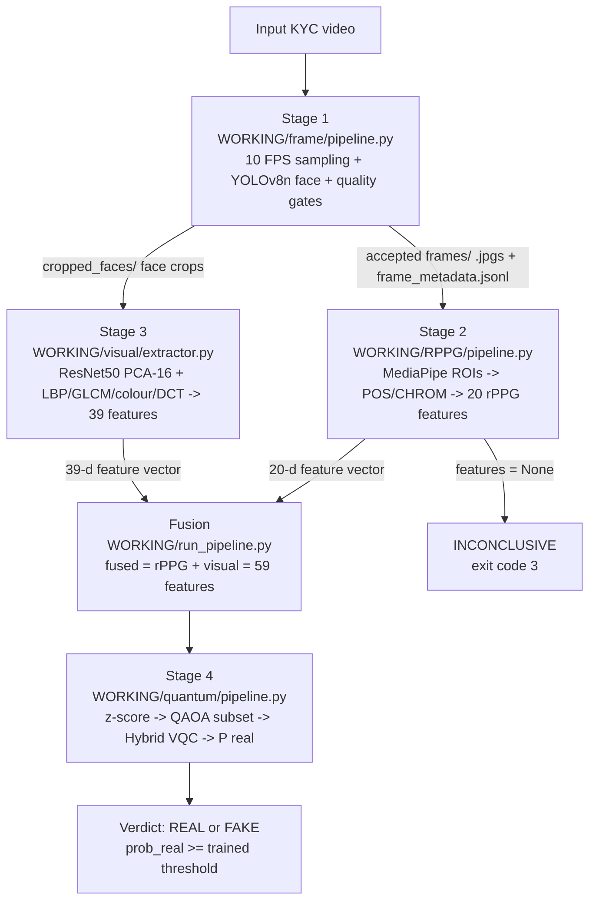
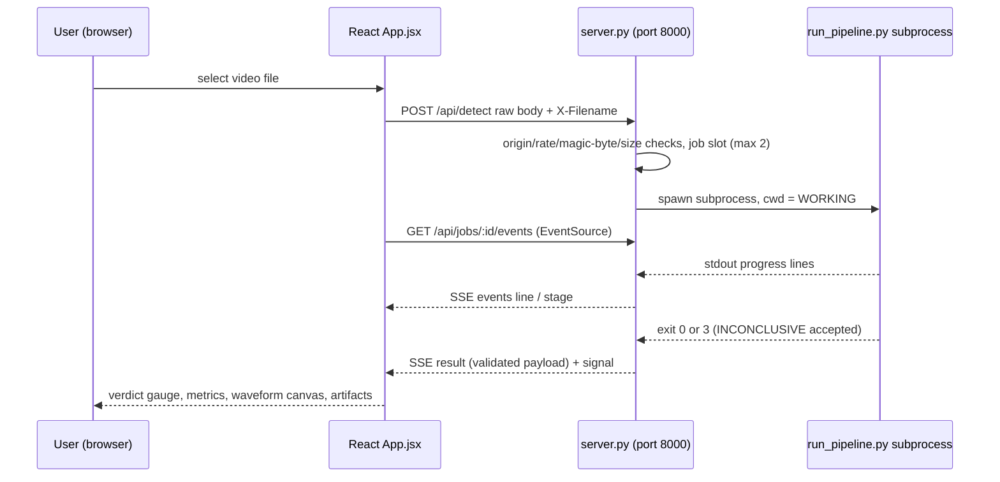

# Deepfake Video Detection for Video KYC Using rPPG and Hybrid Quantum–Classical Machine Learning

> Project documentation prepared from a direct analysis of the repository source code,
> which is treated as the final source of truth. Repository documentation (README files,
> reports, PDFs) was used only as supplementary context; every technical statement below
> is grounded in specific source files, and documented values that conflict with the code
> or with generated artifacts are explicitly flagged. Notation `MAJ_OUTPUT_ROOT` refers to
> the configurable regenerated-artifact root (set via `.env` → `MAJ_OUTPUT_ROOT`;
> the current repository `.env` points it at `WORKING/output`).
> Pipeline version: `p2-1` (`WORKING/run_pipeline.py`, `frontend/contract.py`).

---

## Contents (Table of Contents)

1. [Abstract](#1-abstract)
2. [Introduction](#2-introduction)
3. [System Architecture / Flow Diagram](#3-system-architecture--flow-diagram)
4. [Methodology](#4-methodology)
5. [System Testing](#5-system-testing)
6. [Results & Discussion](#6-results--discussion)
7. [Demonstration of Prototype](#7-demonstration-of-prototype)
8. [Future Works](#8-future-works)
9. [Conclusion](#9-conclusion)
10. [References](#10-references)

*(Per the documentation brief, the slides "Literature Survey" and "Status of Paper" are omitted entirely.)*

---

## 1. Abstract

Video-KYC (know-your-customer) workflows in financial systems are exposed to synthetic-media impersonation attacks in which short, low-resolution, often compressed selfie videos are routed through automated identity verification. This project develops a working deepfake-video detector that combines two complementary evidence channels and a hybrid quantum–classical decision layer:

- **Physiological evidence (rPPG).** The `WORKING/RPPG/` package recovers the remote photoplethysmography pulse from facial skin regions (left cheek, right cheek, forehead) using POS and CHROM blind-source separation and converts the recovered waveform into a 20-dimensional physiological feature vector (`RPPG/features.py`).
- **Appearance evidence (visual).** The `WORKING/visual/` package extracts a 39-dimensional visual descriptor from stage-1 face crops using ResNet50 deep features (PCA-reduced to 16 dimensions) combined with handcrafted LBP, GLCM, colour, and DCT statistics (`visual/extractor.py`).
- **Quantum decision layer.** The `WORKING/quantum/` package selects the most informative features by a QAOA optimiser with supervised Mann–Whitney discrimination weights (`quantum/qaoa.py`) and classifies the selected subset with a hybrid variational quantum classifier (VQC) built on PennyLane and PyTorch (`quantum/vqc.py`), producing `P(real)` and a two-outcome verdict: **REAL** or **FAKE**.

All three channels are orchestrated end-to-end by `WORKING/run_pipeline.py`, which implements the four-stage flow *frames → rPPG → visual → quantum (fused)* over a fused 59-feature contract defined in `quantum/config.py` (`FUSED_FEATURE_NAMES = RPPG_FEATURE_NAMES + VISUAL_FEATURE_NAMES`, 20 + 39). The system is trained and evaluated only on the **DFDC dataset**, is invoked directly by command line, and is served through a standard-library HTTP API (`frontend/server.py`) with a React front end that streams pipeline progress and the recovered pulse waveform in real time. When insufficient usable frames are acquired, the pipeline returns an explicit `INCONCLUSIVE` result with exit code 3 rather than guessing. The current trained artifacts originate from a small smoke-run subsample (38 videos, n = 8 test clips), so the reported metrics are statistically indicative only; a full-dataset run is required for report-grade results.

---

## 2. Introduction

### 2.1 Background and Motivation

Remote identity verification (video KYC) replaces in-person branch checks with a browser camera session. Deepfakes — face-swapped or fully generated videos — can defeat naive appearance inspection, and the attack surface is aggravated by the *low-resolution, short, compressed* nature of streamed KYC video. A growing corpus of research in the repository (`Docs/maj_proj_report_sem_6/research_paper/`) studies both CNN/vision-transformer appearance forensics and blood-volume-based "rPPG" forgery detection, and the project's own prior reports (`Docs/maj_proj_report_sem_6/SEM6_report/Final_report_draft_V3.pdf`, `project_system_document.pdf`) motivated a *multi-evidence* design: forged faces typically preserve appearance plausibility while failing to reproduce the subtle cardiac-driven skin-colour oscillation that rPPG measures.

### 2.2 Problem Statement

The project answers the following question: given a single uploaded KYC video, decide — automatically, explainably, and with defined failure behaviour — whether the clip portrays a **real recorded person** or a **deepfake**, while remaining tolerant of low-quality inputs. The measured objectives encoded in the codebase are:

- fuse independent physiological and appearance evidence instead of relying on a single channel (`run_pipeline.py` fuses both vectors);
- make the final decision a single, reproducible number `P(real)` from one decision layer only — the quantum stage (`quantum/pipeline.py:predict_features`); a RandomForest on rPPG features (`RPPG/train_classifier.py`) is retained explicitly as a *cross-check*, not a decision maker;
- never silently guess: if rPPG returns `features=None` (`RPPG/pipeline.py` contracts: fewer than 24 usable frames or signal quality < 0.05), the pipeline emits `INCONCLUSIVE` and exits with status 3 (`run_pipeline.py:main`);
- keep a strict, test-enforced feature contract so that training-time and inference-time features can never diverge (`quantum/tests.py::test_feature_contract_sync`, `tests/quantum/test_selection_mapping.py`).

### 2.3 Objectives

The implemented objectives, each traceable to code:

- **O1 — Frame acquisition and gating.** Sample a controlled 10 FPS sequence, detect faces with YOLO, and reject unusable frames (blur/dark/bright/no-face/too-small/extreme-pose) before downstream stages (`frame/pipeline.py`).
- **O2 — Physiological signal recovery.** Reconstruct the per-video pulse via POS/CHROM on three skin ROIs and derive 20 physiological descriptors (`RPPG/signal_extraction.py`, `RPPG/features.py`).
- **O3 — Appearance descriptors.** Compute 16 deep + 23 handcrafted visual features from face crops (`visual/extractor.py`).
- **O4 — Feature fusion.** Inner-join rPPG and visual tables on normalised video stem into a 59-feature labelled table (`visual/pipeline.py::fuse_features`).
- **O5 — Quantum feature selection.** Use QAOA with a validated, exact cost Hamiltonian to select a 3-feature subset from a classically pre-selected 18-feature candidate pool (`quantum/qaoa.py`, `quantum/qaoa_sim.py`).
- **O6 — Hybrid classification.** Train an angle-encoded variational quantum circuit with a small classical head, using class-balanced focal loss and early stopping (`quantum/vqc.py::train_vqc`).
- **O7 — Verified evaluation.** Produce accuracy/recall/AUC/ECE metrics, subject-grouped 5-fold cross-validation, ROC/confusion/calibration plots, and classical baselines for comparison (`quantum/evaluation.py`).
- **O8 — End-to-end delivery.** Expose a CLI (`run_pipeline.py`) and a web prototype (upload → live progress → verdict dossier) with defensive API behaviour (`frontend/server.py`).

### 2.4 Scope and Enforced Constraints

The repository rulebook (`AGENTS.md`) and code enforce a deliberately narrow, supported configuration:

- **Fused mode only.** `FEATURE_SET_CONFIGS` contains only `"fused"` (`quantum/pipeline.py:43`); rPPG-only, visual-only and ablation feature sets are removed (`config.py` keeps empty legacy placeholders `PHASE6_FEATURE_SETS = {}`, `PHASE7_ABLATION_SETS = {}`).
- **DFDC only.** `DFDC_DATASET_PATH` must point at `archive/DFDC_Dataset`; FF++ is not supported.
- **Stage-coupled label conventions (intentionally not unified):** rPPG CSV labels use `1 = fake`; quantum labels use `LABEL_REAL = 1, LABEL_FAKE = 0` with the flip isolated in `quantum/data.py::csv_to_quantum_label` (returns `1 - csv_label`); the rPPG RandomForest cross-check uses `1 = DEEPFAKE`.
- **Two decision outcomes only:** `REAL` or `FAKE`. Extraction-level failure produces `INCONCLUSIVE` + exit code 3 (input contract of `frontend/contract.py::VERDICTS`); no "review required" state exists.
- **No synthetic data.** The quantum layer consumes only the real fused table `MAJ_OUTPUT_ROOT/visual/fused_features.csv`; no generator or "bridge" transform exists in code.
- **Artifact integrity.** Every persisted quantum artifact is written with a SHA-256 sidecar and refused on load if unsigned (`quantum/config.py::verify_sha256`, `::write_sha256`), and checkpoints carry a `feature_schema_sha256` digest that must match the live schema (`quantum/pipeline.py:112`).

---

## 3. System Architecture / Flow Diagram

### 3.1 High-Level Architecture



Stage 1 feeds **both** evidence stages: accepted JPEG frames (`MAJ_OUTPUT_ROOT/frames/frame_sequences/<video>/frames/`) plus `frame_metadata.jsonl` are handed to `RPPGPipeline.process_frames()` (stage-2 entry, `RPPG/pipeline.py`), and the sibling `cropped_faces/` crops are consumed by `visual.extractor.compute_visual_features()` (stage 3, `run_pipeline.py:run_visual_stage`). If stage 1 fails or yields no frames, the orchestrator falls back to `RPPGPipeline.process_video()` (direct video decode), recorded in the result JSON as `input_mode = video_direct`.

### 3.2 Repository Layout (code units)

| Path | Role in the system |
|---|---|
| `WORKING/frame/` (3 modules) | Stage 1: `pipeline.py` (sampling/quality layer + CLI), `detector.py` (YOLO wrapper), `processing.py` (frame ingest, quality assessor), `weights/` |
| `WORKING/RPPG/` (10 modules) | Stage 2: `pipeline.py`, `signal_extraction.py`, `features.py`, `face_roi.py`, `preprocessing.py`, `gpu_face_detector.py`, `pqs.py`, `extract_dataset_features.py`, `train_classifier.py` |
| `WORKING/visual/` (3 modules) | Stage 3: `extractor.py`, `pipeline.py`, `__init__.py` |
| `WORKING/quantum/` (12 modules) | Stage 4: `config.py`, `data.py`, `qaoa.py`, `qaoa_sim.py`, `vqc.py`, `pipeline.py`, `evaluation.py`, `explain.py`, `scaling.py`, `operations.py`, `tests.py` |
| `WORKING/run_pipeline.py` | End-to-end orchestrator (CLI; stages 1–4; result JSON; exit codes 0/2/3) |
| `frontend/server.py` + `frontend/contract.py` | Standard-library API server (jobs, SSE, upload validation, artifact serving) and result-payload validator |
| `frontend/src/` | React + Vite UI (11 components, SSE client, waveform canvas) |
| `tests/` | Pytest suite: `rppg/`, `visual/`, `quantum/`, `integration/`, `fixtures/` |
| `requirements.txt`, `pyproject.toml` | Pinned dependencies and tooling configuration |
| `setup_and_run.ps1` | Idempotent one-shot setup + full training/inference runner (Windows) |
| `Docs/`, `changes.md`, `AGENTS.md` | Reports and PDFs (reference material), mandatory change log, repository rulebook |

### 3.3 Regenerated Artifact Flow

All generated artifacts live under `MAJ_OUTPUT_ROOT` (gitignored; regenerated by design) and follow the merged schema below.

| Artifact | Producer | Consumer |
|---|---|---|
| `frames/frame_sequences/<v>/frames/*.jpg`, `cropped_faces/*.jpg`, `frame_metadata.jsonl` | `frame/pipeline.py` | rPPG stage 2, visual stage 3, frontend frame gallery |
| `rppg/dataset_features.csv` | `RPPG/extract_dataset_features.py` | visual fusion, rPPG classifier training |
| `rppg/rppg_classifier.pkl` + `.sha256` + metadata | `RPPG/train_classifier.py` | `run_pipeline.py` cross-check only (treated as untrusted pickle) |
| `visual/visual_features.csv`, `visual/fused_features.csv`, `visual_pca.npz` | `visual/pipeline.py` | quantum data build |
| `visual/experiments/` split manifest files | `visual/pipeline.py::create_experiment_splits` | provenance of the subject-grouped split |
| `quantum/data_fused.npz`, `feature_scaler_fused.json`, `qaoa_selection_fused.json`, `hybrid_vqc_fused.pt` + `.sha256`, `split_manifest_fused.json` | `quantum/data.py`, `quantum/scaling.py`, `quantum/qaoa.py`, `quantum/vqc.py` | `quantum/pipeline.py::predict_features` (inference), frontend quantum panel |
| `quantum/metrics_quantum.json`, `metrics_baselines.json`, `training_log.jsonl`, plots (`.png`) | `quantum/evaluation.py` | reporting; **currently absent** from `WORKING/output` (must be regenerated) |
| `pipeline/pipeline_result.json`, `pipeline_experiments.jsonl` | `run_pipeline.py` | frontend `/api/previous` and evidence dossier |

### 3.4 Orchestrator Contract (`WORKING/run_pipeline.py`)

- **CLI:** `python run_pipeline.py --source <video> [--method POS|CHROM] [--out result.json] [--signal-out signal.json]`.
- **Execution order:** `[1/4] FRAMES` → `[2/4] RPPG` → `[3/4] VISUAL` → `[4/4] QUANTUM`; the heavy quantum import (torch) is deferred until stage 4 so early progress lines stream immediately.
- **Exit codes:** `0` = decided verdict; `2` = missing input video; `3` = `INCONCLUSIVE` (rPPG `features=None` or visual extraction failure).
- **Result JSON** contains `verdict`, `stages.frames/rppg/visual/quantum`, `diagnostics` (processing time, frame counts, SQI, memory snapshot from `quantum/operations.py::memory_snapshot`) and appends an experiment record to `pipeline/pipeline_experiments.jsonl`.
- **Signal emission:** `emit_signal()` writes a decimated waveform (≤ 600 points, `NaN` sentinels) so the UI can plot the pulse without reprocessing the video.

### 3.5 Web Subsystem



| Endpoint | Behaviour ( enforced in `frontend/server.py`) |
|---|---|
| `POST /api/detect` | 200 MB cap (streamed 64 KB chunks to a private inbox), magic-byte signature check (MP4/MOV `ftyp`, AVI `RIFF`, WebM/MKV EBML → else 415), per-IP rate limit 10/min, max 2 concurrent jobs (429 otherwise), disallowed `Origin` → 403 |
| `GET /api/jobs/<id>` | `{done, error, video, signal, lines[-400:], result, api_version}` |
| `GET /api/jobs/<id>/events` | SSE stream: `line`, `stage`, terminal `result` / `error` / `signal`, 20 s `ping` heartbeat; reconnect-safe drain |
| `GET /api/previous` | Last canonical pipeline result from `MAJ_OUTPUT_ROOT/pipeline/pipeline_result.json` |
| `GET /api/health` | `{ok, platform, running, has_previous, sequences, artifacts}` |
| `GET /api/artifacts?dir=` | Recursive listing under `MAJ_OUTPUT_ROOT/<rel>` with traversal protection |
| `GET /api/files?rel=` | Serves artifact bytes (MIME-guessed, `Cache-Control: no-store`), same traversal guard |

Operational limits: job records expire after 1 h, frame sequences after 24 h, each pipeline run has a hard 30-minute timeout (`JOB_RUN_TIMEOUT_SECONDS`), and CORS is restricted to configurable localhost origins (`ALLOWED_ORIGINS`). The result payload is schema-validated by `frontend/contract.py::validate_result_payload` (label ∈ {REAL, FAKE, INCONCLUSIVE}, confidence ∈ [0, 1] or `null`) before public emission.

### 3.6 Hardware and Runtime Environment (as configured in code)

- PyTorch 2.5.1 + CUDA 12.1 wheels (`requirements.txt`); CUDA head for VQC training when available (`quantum/vqc.py` via `operations.resolve_torch_device`).
- GPU rPPG extraction uses YuNet face detection through ONNX Runtime GPU 1.20.2 (`RPPG/gpu_face_detector.py`; the pin is deliberate — ORT 1.18 cannot load the cuDNN 9 runtime bundled with PyTorch 2.5.1).
- Default quantum backends are the project's exact torch-native statevector simulators (`qaoa_sim.QAOASimulator`, `vqc.QuantumLayerTorch`, complex128); PennyLane paths remain only as cross-verification options.
- `TORCH_COMPILE_DISABLE=1` is set by `setup_and_run.ps1` (Triton is unavailable on Windows).

---

## 4. Methodology

### 4.1 Stage 1 — Frame Sampling and Quality Filtering (`WORKING/frame/`)

Implemented by `frame.pipeline.run_frame_sampling_quality_layer()` (called directly by the orchestrator) and the standalone CLI `python -m frame.pipeline`:

- **Sampling.** `FrameIngestor.frames(sample_fps=10)` samples by timestamp (preferred) with a stride fallback `round(source_fps / sample_fps)` when `CAP_PROP_POS_MSEC` is unreliable; a minimum accepted sequence of 32 frames is required.
- **Face detection.** `FaceDetector` wraps Ultralytics YOLO on `frame/weights/yolov8n-face-lindevs.pt` (auto-download for this weight only; other presets must exist on disk), confidence 0.25, inference size 320.
- **Quality gating.** `FrameQualityAssessor` rejects frames by the exact rules:

| Rejection rule | Threshold | Rationale (DFDC-tuned, relaxed for short/low-quality clips) |
|---|---|---|
| `blur` | Laplacian variance < 3.0 | defocus/motion smear destroys rPPG band |
| `dark_frame` | grayscale mean < 30.0 | insufficient SNR |
| `overexposed_frame` | grayscale mean > 235.0 | saturated channels |
| `no_face` | zero YOLO detections | mandatory for rPPG/visual crops |
| `face_too_small` | largest face area ratio < 0.002 | rPPG skin ROI ≥ ~48 px required |
| `extreme_pose` | box aspect ratio < 0.65 or > 1.7 | profile/rolled views (edge-touch intentionally **not** rejected for 112×112 DFDC tiles) |

- **Composite quality score:** `0.4·blur + 0.3·brightness + 0.3·face_confidence` (`frame/processing.py`).
- **Outputs per video:** `frames/frame_%06d_t%010d.jpg`, sibling `cropped_faces/` for stage 3, `frame_metadata.jsonl` (per-frame quality records), summary JSON with acceptance statistics and an `rppg_input_ready` flag (absence of face < 48×48 px and green-channel variation > 0.5 std).
- **Fallback:** if `run_pipeline.py` receives no usable frames dir, it calls `RPPGPipeline.process_video()` on the source file directly.

### 4.2 Stage 2 — rPPG Feature Extraction (`WORKING/RPPG/`)

- **Face ROIs.** `FaceROIExtractor` uses the MediaPipe Face Landmarker (468 points, bundle `face_landmarker.task` with SHA-256 verification; Haar-cascade fallback), EMA landmark smoothing (α = 0.6), and derives three skin polygon masks — **left cheek, right cheek, forehead**. Rigid motion compensation (`cv2.estimateAffinePartial2D`) is applied before sampling; an optional YCrCb skin mask (Cr 115–190, Cb 60–145) applies only to frames ≥ 200 px height; an ROI with < 3 valid pixels is skipped.
- **Pulse reconstruction** (`RPPG/signal_extraction.py`): per ROI, POS (Wang et al., 2017 — fixed projection `P = [[0,1,-1],[-2,1,1]]`, ~1.6 s sliding windows, per-window chrominance ratio α) or CHROM (de Haan & Jeanne, 2013) is applied to the (T,3) RGB matrix; an ROI is retained only if ≥ 30 % of samples are valid. ROI signals are combined with weights **0.35 / 0.35 / 0.30**.
- **Signal conditioning** (`RPPG/preprocessing.py`): NaN-interpolation → smoothness-prior detrending (Tarvainen et al., 2002, λ = 300) → zero-phase Butterworth band-pass **0.7–4.0 Hz (42–240 BPM)**, order adapted (4 native, 2–3 for short signals) → z-score normalisation.
- **Feature computation** (`RPPG/features.py`): one shared zero-padded Welch PSD plus time-domain pulse analysis produce the 20 features (also mirrored in `quantum/config.py::RPPG_FEATURE_NAMES`):

| Group | Feature names |
|---|---|
| Global signal (6) | `heart_rate_bpm`, `snr_db`, `prv_std_ms`, `spectral_entropy`, `mad`, `signal_quality_index` |
| Cross-ROI consistency (3) | `cheek_forehead_correlation`, `left_right_cheek_correlation`, `hr_half_diff` |
| Pulse morphology (3) | `peak_prominence`, `systolic_peak_width`, `diastolic_notch_ratio` |
| Robustness / probes (5) | `forehead_cheek_phase_lag`, `signal_to_motion_ratio`, `peak_amplitude_variability`, `pulse_transit_time_proxy`, `phase_coherence_lr` |
| Spectral shape (3) | `spectral_flatness`, `spectral_centroid`, `kurtosis` |

- **Failure contract (numerical, not probabilistic).** `features=None` is returned — with staged diagnostics — when: no face in any frame (`NO_FACE`), usable frames < **24** (`INSUFFICIENT_FRAMES`), no valid ROI signal (all < 30 % valid), or a degenerate combined signal (SQI < **0.05**).
- **Quality scoring.** `RPPG/pqs.py` computes a Physiological Quality Score (PQS) in [0, 1] as a weighted diagnostic (SNR, frame utilisation, ROI validity, cross-ROI consistency, frequency stability, amplitude, temporal consistency) with tiers HIGH ≥ 0.7 / LOW ≤ 0.3 — informational only; it never changes the verdict.
- **Dataset-scale extraction.** `RPPG/extract_dataset_features.py` walks the DFDC tree (labels `1 = fake`, `0 = real`), optionally using the GPU YuNet detector (`gpu_face_detector.py`: 640×640 input, strides 8/16/32, conf 0.6, NMS IoU 0.3) with CUDA-12 preflight and an explicit GPU failure policy, multiprocessing workers (optionally 8 GPU workers), per-sample atomic checkpointing + resume (`--resume`, identity-vs-runtime flag split), an exclusive lock file, and WinError-5-resilient atomic CSV appends.
- **Cross-check classifier.** `RPPG/train_classifier.py` trains `SimpleImputer(median) → RandomForestClassifier(n_estimators=600, class_weight="balanced_subsample", min_samples_leaf=2)` on the 20 features (`1 = DEEPFAKE`), with SHA-256-signed model artifact; the result is *informational only* — the final verdict is exclusively quantum.

### 4.3 Stage 3 — Visual Feature Extraction (`WORKING/visual/`)

`visual/extractor.py` derives 39 features per video from face crops (`frame_%06d_face_*.jpg` of stage 1; deterministic centre-crop fallback):

| Group | Count | Computation |
|---|---|---|
| Deep | 16 | ResNet50 (`IMAGENET1K_V2`, FC removed) → 2048-d GAP per frame, BGR→RGB, resize 224, ImageNet normalisation; frame-averaged, then reduced by a **training-fitted PCA** persisted to `visual_pca.npz` (non-pickle, `allow_pickle=False`, validates `n_features_in=2048`, `n_components=16`, preprocessing version) |
| Texture: LBP | 10 | `skimage.feature.local_binary_pattern` (radius 1, 8 samples, `uniform`), 10-bin density histogram |
| Texture: GLCM | 4 | 32 grey levels, distance 1, four angles {0, π/4, π/2, 3π/4}, symmetric+normalised; mean of contrast/energy/homogeneity/correlation |
| Colour | 6 | per-channel mean and std of the raw crop (BGR reordered to R/G/B) |
| Frequency: DCT | 3 | 64×64 greyscale crop, `cv2.dct`; energy shares of the low (0–8), mid (8–24), high (24+) bands |

`visual/pipeline.py` performs dataset-scale extraction for training: it fits the PCA **only on training-partition videos** (fitting is never implicit at inference), writes `visual_features.csv` with a cache-fingerprint metadata sidecar, and fuses with the rPPG CSV by `fuse_features()` (inner join on normalised video stem; labels `1 = fake` retained from the rPPG table) producing `visual/fused_features.csv`. `create_experiment_splits` then computes the canonical subject-grouped split and persists `fused_split.npz`, `split_indices.npz`, `split_manifest.json`.

### 4.4 Stage 4 — Quantum Feature Selection and Classification (`WORKING/quantum/`)

#### 4.4.1 Data construction and protocol (`quantum/data.py`)

- `build_dataset()` loads `MAJ_OUTPUT_ROOT/visual/fused_features.csv` **only** (fused mode), drops rows with non-finite feature values or `heart_rate_bpm` outside **30–220 BPM**, and converts labels exclusively through `csv_to_quantum_label()` (rPPG `1=fake` → quantum `LABEL_FAKE=0`; `LABEL_REAL=1`).
- Splitting is **subject-grouped and seeded deterministic**: groups are inferred metadata-first (`subject_id`, `identity_id`, `original_video_id`, `source_video_id`, `source_id`, `group_id`, `video_sha256`… × `*_id`/`*_sha256` columns) with a `clip:<path>` fallback; per-class targets are 20 % validation / 20 % test; mixed-label groups are allocated first, then single-class groups greedily; `_assert_no_group_leakage` aborts on cross-split group reuse. A `split_manifest_fused.json` records provenance. The output `data_fused.npz` stores `X/y/groups/paths` per split plus `feature_names`.

#### 4.4.2 QAOA feature selection (`quantum/qaoa.py`, verified by `qaoa_sim.py`)

- **Classical cost** for selection bitstring `b`: `C(b) = −wᵀb + 0.3·(Σᵢ<ⱼ Cᵢⱼ bᵢbⱼ − ½Σb) + 0.5·(Σb − k)²`, with supervised discrimination weights `wⱼ = 2·|AUCⱼ − 0.5|` from the exact Mann–Whitney U statistic (sign-agnostic, no learning); `k = target_features = 3`.
- **Hamiltonian equivalence.** `_cost_terms` expands the same objective into a diagonal Pauli-Z Hamiltonian; `verify_hamiltonian()` checks agreement over basis and random bitstrings and `pipeline.py` **hard-asserts error < 1e-6** before proceeding.
- **Optimisation.** Hadamards → p = 3 alternating layers of exact precomputed cost gates and X-mixer rotations (`_apply_qaoa` keeps γ/β roles distinct — regression-guarded by `test_beta_alive`), minimised by COBYLA (maxiter 500) over **8 parallel restarts**; best restart by expected cost; final selection = top-3 marginal-probability features.
- **Backends.** Default is the exact torch-native complex128 statevector simulator `qaoa_sim.QAOASimulator` (CPU-process-safe, ~0.3–0.5 ms per 20-qubit call per module docstring) with a retained PennyLane path for cross-verification (≤ 1e-6 agreement enforced by `test_qaoa_sim_matches_pennylane`).
- **Scale handling.** Because the statevector backend caps at 20 wires, the pipeline classically pre-selects **18 candidate features** (AUC-strength ranking) when 59 > 20; the search runs on these 18, and `remap_selection_to_original_space()` translates the winning local indices back into the original 59-feature space **before** persisting `qaoa_selection_fused.json` (regression-fixed defect D1; guarded by `tests/quantum/test_selection_mapping.py`).
- **Stability reporting.** Per-feature restart frequency and pairwise Jaccard overlap (`selection_stability`) are saved with the selection; `compare_selections` also records overlap with the classical top-k (`selection_comparison_fused.json`).

#### 4.4.3 Hybrid VQC (`quantum/vqc.py`)

- **Architecture.** AngleEmbedding-Y on the selected features → `StronglyEntanglingLayers` (3 layers) → per-qubit ⟨Z⟩ expectations → classical head `Linear(8) → ReLU → Dropout(0.2) → Linear(1)`; logit → sigmoid = `P(real)`.
- **Backends.** `QuantumLayerTorch` (default) is an exact complex128 statevector implementation matching the PennyLane circuit (CNOT permutation tables, batched gates; checkpoint-compatible weight shapes); `QuantumLayer` retains `default.qubit(.torch)` for GPU/cross-checks (≤ 1e-5 agreement pinned by tests).
- **Training.** Class-balanced **focal loss** (α = 0.45 weighting the REAL class, γ = 1.0, label smoothing ε = 0.03), AdamW (lr 5e-2, wd 1e-2), batch 256, cosine-annealed LR with 3-epoch warmup, gradient clipping 1.0, CUDA AMP when available; **early stopping** patience 12 on validation focal loss with best-state restore; max 80 epochs.
- **Artifacts.** Checkpoint = state dict + metadata (QAOA indices, `feature_names`, scaler statistics, configs, `feature_schema_sha256`, and a Youden-optimal decision threshold tuned on the validation split — `evaluation.optimal_threshold_youden`), written with a `.sha256` sidecar; loading re-verifies the checksum and schema and refuses tampering.

#### 4.4.4 Evaluation and baselines (`quantum/evaluation.py`)

Accuracy/precision/recall/F1/AUC-ROC/ECE/Brier, decision bins, ROC + confusion-matrix + calibration plots, **subject-grouped 5-fold cross-validation** (mean ± std, balanced accuracy included), and classical baselines on the same selected features: RandomForest, MLP(32,16), LogisticRegression, calibrated LinearSVC, GaussianNB, and optional XGBoost.

### 4.5 Inference Path (`quantum.pipeline.predict_features`, consumed by `run_pipeline.py`)

1. Validate that the incoming feature dict **exactly matches** the canonical ordered `FUSED_FEATURE_NAMES` (hard `ValueError` otherwise).
2. z-score with the **train-fitted** `feature_scaler_fused.json` (never re-fitted at inference).
3. Apply the persisted, remapped QAOA indices (range-guarded) to build the small feature vector.
4. Load the checkpoint via `load_vqc_model` (checksum + schema verified); obtain `P(real)`.
5. Threshold: `decision_threshold` from checkpoint metadata (Youden-tuned; default 0.5). `REAL` iff `P(real) ≥ threshold`, else `FAKE`; confidence = `2·|P(real) − 0.5|`; a `DecisionExplanation` dossier (physiological + selected visual evidence via `quantum/explain.py`) is attached.

### 4.6 Reliability and Security Measures (implemented)

- SHA-256 sidecar + schema-digest verification for every loadable quantum artifact (`quantum/config.py`).
- `rppg/rppg_classifier.pkl` is treated as untrusted serialized code; inference keeps `MAJ_OUTPUT_ROOT/rppg/` write-protected (`AGENTS.md` security constraints mirrored in `run_pipeline.py` usage).
- Upload hardening: 200 MB streaming cap, magic-byte signature check, path-traversal-proof artifact access, CORS allow-list, rate limit, job-concurrency semaphore, timeouts (`frontend/server.py`).
- Atomic writes with retry/backoff for CSV/checkpoint updates and an exclusive lock during dataset extraction (`RPPG/extract_dataset_features.py`).

---

## 5. System Testing

### 5.1 Test Strategy

Testing spans four layers, executed manually (no CI configuration exists — `.github/` contains only repository-agent guidance):

1. **Structural self-checks:** `python -m quantum.tests` — invariants of the quantum layer (feature contract, Hamiltonian identity, simulators, checkpoints, labels, splits).
2. **Unit/integration pytest suite** (`tests/`, wired via `pyproject.toml [tool.pytest.ini_options]`, testpaths `tests`, with `slow`/`integration`/`gpu` markers): rPPG, visual, quantum, integration.
3. **Contract/append-only guards:** `tests/quantum/test_selection_mapping.py` (train/inference column identity, D1 regression), `tests/visual` (39-name contract equality with `quantum` config).
4. **End-to-end validation runs:** `setup_and_run.ps1 -Quick`, `python run_pipeline.py --source test1.mp4`, `npm run build` for the frontend.

### 5.2 Quantum Self-Check Suite (`WORKING/quantum/tests.py`)

The runner `main()` registers **10 checks** (11 test functions are defined; `test_label_conversion` runs separately):

| Check | Verifies |
|---|---|
| `test_beta_alive` | mixer β parameters remain non-trivial in the QAOA ansatz after `_apply_qaoa` refactor |
| `test_hamiltonian_matches_classical` | cost Hamiltonian expectation ≡ classical objective on constructed bitstrings |
| `test_real_hamiltonian_verification` | the equivalence holds with the real discrimination weights on actual data |
| `test_feature_contract_sync` | `quantum.config.FUSED_FEATURE_NAMES` (59) exactly equals `RPPGFeatures.feature_names()` + `VISUAL_FEATURE_NAMES`, name **and order** |
| `test_split_determinism` | identical configuration regenerates an identical subject-grouped split |
| `test_dfdc_subject_grouping` | DFDC metadata produces correct group keys (clips of the same subject share a group) |
| `test_no_group_leakage` | `_assert_no_group_leakage` rejects cross-split group reuse |
| `test_qaoa_sim_matches_pennylane` | torch-native QAOA simulator ≡ PennyLane (≤ 1e-6) |
| `test_torch_layer_matches_pennylane` | torch-native VQC layer ≡ PennyLane QNode (≤ 1e-5) |
| `test_checkpoint_state_dict_compat` | saved checkpoints reload into the model with matching shapes/metadata |

Harness output: `PASS/FAIL` per check and a `N/10 checks passed` summary; exit code 1 on any failure.

### 5.3 Pytest Suite Inventory (`tests/`)

| Module | Focus |
|---|---|
| `tests/rppg/test_pipeline.py` (5 test classes) | RPPGResult semantics, frame quality rules, pipeline end states, feature vector properties, edge cases |
| `tests/rppg/test_sample_data.py` (2) | synthetic signal generators and edge cases used as deterministic fixtures |
| `tests/rppg/test_extract_csv.py` (2) | atomic CSV replace with retry and the extraction lock behaviour |
| `tests/rppg/test_resume.py` | identity-vs-runtime flag split for `--resume` (identity mismatch refuses, runtime mismatch warns) |
| `tests/visual/test_visual.py` (3) | feature dataclass/naming contract, extractor behaviour, edge cases; asserts `VISUAL_FEATURE_NAMES == quantum.config.VISUAL_FEATURE_NAMES` (39/39) |
| `tests/quantum/test_config.py` (2 classes) | configuration surfaces and evaluation metrics |
| `tests/quantum/test_quantum.py` | imports 11 shared checks from `quantum.tests` + 2 suite-specific tests (metadata grouping, manifest integrity) |
| `tests/quantum/test_selection_mapping.py` (8) | fused-contract size 59, local→original index remap, identity without preselect, feature-name plumbing and mismatch rejection, train/inference column identity, range guard in `predict_features` |
| `tests/integration/test_integration.py` (5 classes) | full pipeline integration incl. PQS and binary decision behaviour |
| `tests/fixtures/sample_data.py` | shared deterministic sample data |

Recorded status (most recent full run recorded in `changes.md`, 2026-10-15): **82 passed / 4 skipped** for the pytest suite and **10/10** for `python -m quantum.tests`. The skips are pre-existing environment-dependent cases (e.g., ResNet weight downloads); they are not new failures. *Not determinable from the codebase:* any additional test coverage statistics (no coverage tooling is configured).

### 5.4 Integrity and Regression Guards Worth Highlighting

- **Artifact tamper-resistance:** `verify_sha256` refuses unsigned or altered artifacts before any load (`quantum/config.py`), exercised silently by every `predict_features` call.
- **Schema binding:** checkpoint `feature_schema_sha256` must equal `schema_digest(FUSED_FEATURE_NAMES)` (`quantum/pipeline.py:112`).
- **Column-identity guarantee:** training and inference must select exactly the same columns — enforced structurally by the remap tests after defect D1 (`tests/quantum/test_selection_mapping.py::test_training_and_inference_use_identical_columns`).
- **Hamiltonian fidelity:** the pipeline aborts if `verify_hamiltonian` exceeds 1e-6 error (`quantum/pipeline.py`).

### 5.5 Validation Commands

| Change area | Command (working directory) |
|---|---|
| Quantum config/QAOA/VQC/labels/features | `python -m quantum.tests` (from `WORKING/`) |
| Any Python-layer change | `pytest tests` (repository root) |
| Full quantum/artifact regeneration | `python -m quantum.pipeline --all` (from `WORKING/`) |
| Inference path | `python run_pipeline.py --source test1.mp4 --out result.json` (from `WORKING/`) |
| Frontend | `npm run build` (from `frontend/`) |
| Full setup + regeneration | `.\setup_and_run.ps1` (idempotent; `-Quick` for the smoke path) |

### 5.6 Issues Identified During This Code Review (current as of the analysis date)

- **Stage-tag mismatch in the web UI live progress.** `run_pipeline.py` prints `[1/4]…[4/4]`, but both `frontend/server.py:85` (`STAGE_TAGS = ("[1/3]", "[2/3]", "[3/3]")`) and `frontend/src/App.jsx:97` (regex `\[(\d)\/3\]`) still expect three stages; consequently `stage` SSE events are never emitted and the 7-step progress timeline freezes until the terminal `result` event sets `stageIdx = 3`. Functionality (lines, result, signal) is unaffected; the stage stepper mapping in `frontend/src/lib.js::stageActive` is unreachable.
- Four pre-existing pytest skips (weight-download-dependent), documented rather than coded as failures.
- See §6.7 for documentation-vs-code discrepancies surfaced during testing of claims.

---

## 6. Results & Discussion

### 6.1 Experimental Setup and Provenance

- Training data: DFDC (`DFDC_DATASET_PATH` → `archive/DFDC_Dataset`), fused 59-feature table built via stages 1–3 and fusion (`visual/fused_features.csv`).
- The **most recent completed training artifacts** recorded in repository documentation were generated by a **38-video smoke run** (20 fake / 18 real) of `setup_and_run.ps1 -Quick` (2026-10-11), producing `data_fused.npz`, selection, scaler, checkpoint, `metrics_quantum.json`, `metrics_baselines.json`, `training_log.jsonl` and the standard plots.
- **Current tree status:** the quantum artifacts have since been cleared from `WORKING/output/` (only the rPPG extraction artifacts `rppg/dataset_features.csv`, `checkpoint.json`, and an `extraction.lck` are present). The tables below therefore reproduce the figures **as audited from those artifacts** in `PROJECT_RESEARCH_REPORT.md` (§11–§13); they are statistically limited (test split **n = 8** clips) and must be regenerated with a full-dataset `python -m quantum.pipeline --all` run for report-grade results.

### 6.2 Quantum Model (Hybrid VQC) — Test Split

Read from the recorded `metrics_quantum.json` (evaluation used the Youden-tuned decision threshold **0.5068** stored in the checkpoint metadata):

| Metric | Value |
|---|---|
| Accuracy | 0.500 |
| Precision | 0.500 |
| Recall (REAL sensitivity) | 0.750 |
| Specificity (FAKE recall) | 0.250 |
| Balanced accuracy | 0.500 |
| F1 score | 0.600 |
| AUC-ROC | 0.5625 |
| PR-AUC | 0.6679 |
| Brier score | 0.2465 |
| Expected calibration error (ECE) | 0.1881 |
| Coverage | 8/8 classified |

|  | Predicted REAL | Predicted FAKE |
|---|---|---|
| **True REAL** | 1 | 3 |
| **True FAKE** | 1 | 3 |

### 6.3 Cross-Validation (subject-grouped 5-fold, recorded)

| Metric | VQC mean | VQC ± std |
|---|---|---|
| Accuracy | 0.700 | ± 0.197 |
| AUC-ROC | 0.700 | ± 0.267 |
| Balanced accuracy | 0.667 | ± 0.230 |
| F1 | 0.467 | ± 0.400 |

Fold sizes are ~4–5 clips, so fold statistics are dominated by single-clip variance.

### 6.4 Classical Baselines (same test split, recorded from `metrics_baselines.json`)

| Model | Acc | Bal. acc | Precision | Recall | F1 | AUC | ECE |
|---|---|---|---|---|---|---|---|
| RandomForest (200 trees) | 0.500 | 0.500 | 0.500 | 0.750 | 0.600 | 0.500 | 0.186 |
| MLP (32-16) | 0.375 | 0.375 | 0.400 | 0.500 | 0.444 | 0.5625 | 0.538 |
| LogisticRegression | 0.500 | 0.500 | 0.500 | 0.750 | 0.600 | 0.750 | 0.358 |
| LinearSVC (calibrated) | 0.500 | 0.500 | 0.500 | 0.750 | 0.600 | 0.750 | 0.352 |
| GaussianNB | **0.625** | **0.625** | 0.600 | 0.750 | 0.667 | 0.750 | 0.400 |
| XGBoost (300/0.1/3) | **0.625** | **0.625** | 0.667 | 0.500 | 0.571 | 0.656 | 0.241 |
| **Hybrid VQC (project)** | 0.500 | 0.500 | 0.500 | 0.750 | 0.600 | 0.5625 | **0.188** |

Recorded grouped-CV means (accuracy / AUC): RF 0.700 / 0.933, MLP 0.740 / 0.933, LR 0.750 / 0.867, LinearSVC 0.650 / 0.867, GaussianNB 0.560 / 0.767, XGBoost 0.690 / 0.767.

### 6.5 Training Behaviour (recorded from `training_log.jsonl`, 47 epochs)

- Train focal loss fell **0.1818 → 0.0772** (epochs 1 → 47); the best validation loss (**0.1231**) was reached at **epoch 34**, which the early-stopping logic restored.
- Maximum validation accuracy **0.875** first appeared at epoch 34 and recurred across the tracking window — a small-validation artefact of the smoke run (val split ≈ a handful of clips).

### 6.6 Discussion

- **Statistical power.** With an n = 8 test split, every model is statistically indistinguishable from chance; GaussianNB/XGBoost (0.625) even exceed the VQC (0.500), and large CV-vs-test gaps (e.g., RF CV AUC 0.933 vs test 0.5) reflect extreme small-sample variance rather than generalisation. No comparative "quantum beats classical" claim is supportable from this evidence.
- **Feature selection agreement.** The recorded `selection_comparison_fused.json` showed the QAOA top-3 **identical** to the classical top-3 (3/3 overlap). This is a meaningful engineering result — the Hamiltonian optimisation reproduces the supervised ranking on real data — but it did not yet translate into a separation advantage at this scale.
- **Calibration.** The VQC produced the lowest recorded ECE among comparable models (0.188), which matters for KYC thresholding, though again n = 8.
- **Failure behaviour as a result.** The pipeline correctly reproduces its `features=None → INCONCLUSIVE → exit 3` contract (covered by tests and the integration suite); a KYC system can therefore distinguish "decided" from "not enough physiological signal" without guessing.
- **Absent experiments (explicitly not claimed).** There are no recorded ablation results (`PHASE6_FEATURE_SETS`/`PHASE7_ABLATION_SETS` are empty and the retired ablation runner was deleted), no stratified compression/bitrate/resolution robustness experiments, and no measured per-stage latency artifacts; only wall-clock instrumentation exists (`diagnostics.processing_time_seconds`, 30-minute server budget). Related claims are therefore *"Not determinable from the codebase"* until such runs are executed.
- **Documented performance differences.** The rPPG RandomForest cross-check trained on the 38-sample smoke extract; its verdict, shown by the frontend, is diagnostic context only.

### 6.7 Documentation–Code Discrepancies (followed code, noted here)

1. **`README.md` "Current Performance" table** (accuracy 0.552 / balanced 0.499 / AUC 0.535) is **stale** relative to the recorded smoke-run artifacts (0.500 / 0.500 / 0.5625) and still lists "TBD" entries for the classical column that were filled by later runs.
2. **`README.md` Components/panels** — the frontend README describes classes that do not exist (`VerdictGauge`, "Insights", `useJob`/`useSSE` hooks); the implemented set is `VerdictCard`, `KeyMetrics`, `SignalPanel`, `CrossCheck`, `PreviousRun`, etc. (`frontend/src/components/`).
3. **`frontend/src/lib.js:43`** — the progress step copy reads *"Measuring 29 physiological features"*; the implemented contract is **20** rPPG features (59 fused) (`RPPG/features.py`, `quantum/config.py`).
4. **`run_pipeline.py` header docstring** — mentions a "24-feature vector" for stage 2; the implementation produces **20** (`RPPGFeatures.feature_names()`).
5. **`AGENTS.md`/README** describe "REAL/FAKE" only; the executable contract also defines the extraction-failure state `INCONCLUSIVE` (exit 3, `contract.py::VERDICTS`, `run_pipeline.py`), which should be read as an input-validation outcome rather than a classifier class.
6. **Stage-tag drift** between `run_pipeline.py` (`[N/4]`) and the frontend stage mapping (`[N/3]`) — see §5.6.

---

## 7. Demonstration of Prototype

### 7.1 Environment Setup

`setup_and_run.ps1` (repository root) automates everything idempotently: Python venv creation, dependency check/alignment (explicitly asserting `onnxruntime-gpu == 1.20.2` for the cuDNN-9 stack), DFDC path defaults, stage skipping based on existing artifacts (`rppg/dataset_features.csv`, classifier pickle, fused CSV, `data_fused.npz`, selection/scaler/checkpoint `*_fused.*`), rPPG extraction (GPU YuNet by default, `--workers 0`, checkpoint/resume flags `-Resume -Start -End -GpuWorkers`), classifier training, visual fusion + splits, `python -m quantum.pipeline --all`, frontend `npm install` + build, and an optional sample inference (`-Video path`). `-Quick` runs the smoke path (≤ 20 videos/class, evaluated as expected-failure on the first fresh training run of stage 4).

### 7.2 Running the Web Prototype

```powershell
# Terminal 1 — API server (standard library only)
cd frontend
python server.py            # http://127.0.0.1:8000 (FRONTEND_PORT)

# Terminal 2 — development UI (proxies /api to :8000)
npm run dev                 # http://localhost:5173
```

### 7.3 User Walkthrough (state machine in `frontend/src/App.jsx`)

| Phase | UI element and behaviour |
|---|---|
| `idle` | `UploadZone` (drag-and-drop or picker) with the local-only privacy badge (`Header.jsx`) |
| `selected` | `VideoSelected` shows an object-URL preview plus duration/resolution/size and the Start button |
| `running` | `ProcessingView` presents a 7-step timeline (Video received → Frame quality → Face detection → rPPG signal → Feature analysis → Quantum classifier → Final decision) fed by SSE `line` events; stride-limited creeping progress; live console lines filtered of runtime noise (`lib.js::humanStatus`) |
| `done` | `VerdictCard` renders the verdict word and an animated confidence ring of `prob_real` (P(live)); `KeyMetrics` shows heart rate, signal-quality index bar and the RandomForest cross-check banner (`CrossCheck.jsx`); `SignalPanel` draws the recovered pulse on a `<canvas>` with BPM/SQI/ROI-composition chips (35 % / 35 % / 30 %); `PreviousRun` offers the last verification via `/api/previous` and can reopen it |
| `error` | Inline banner; job artifacts and the inbox video are cleaned up server-side |

Theme handling (dark default + light override via `styles.css :root.light`), `prefers-reduced-motion` support, and responsive behaviour from 1920 px down to 375 px are implemented in the stylesheet. SSE consumption in `frontend/src/api.js::stream` closes on terminal `result`/`error` events and switches to error presentation if the progress stream is lost.

### 7.4 Programmatic Demonstration

```powershell
# From WORKING/
python run_pipeline.py --source test1.mp4 --method POS --out result.json --signal-out signal.json
```

The sample clip `test1.mp4` (≈ 19 MB) at the repository root demonstrates the CLI path; the printed banner reports stage progress and the final `FINAL VERDICT: REAL/FAKE (confidence …)`, and `result.json` contains `verdict`, per-stage payloads (`frames.stats`, `rppg.features` with `heart_rate_bpm`, `visual.features`, `quantum.prob_real` + explanation), and `diagnostics` (processing time, frame counts, SQI, memory snapshot).

### 7.5 Recorded Verification Evidence

Per `changes.md`, the UI was previously exercised in Chromium against a mocked `/api/previous` (row content, reopen behaviour, zero console errors, no overflow at 390/720/1280 px) with screenshots stored under `Scrape/ui_*.png`, and end-to-end runs (38-video smoke) completed stage 1→4 with artifacts regenerated. *Not determinable from the codebase:* published deployment URLs or hosted demo access (the prototype is designed to run localhost-only by default).

---

## 8. Future Works

The following directions are grounded in explicit gaps observed in code, artifacts, or audit findings:

- **Full-dataset training run.** Regenerate all quantum artifacts with the complete DFDC sample (the current evidence base is a 38-video smoke run) and reconcile the stale performance table in `README.md` with the new `metrics_*` outputs.
- **Ablation study machinery.** The fused-only policy removed rPPG-only/visual-only configurations (`config.py` placeholders remain empty); a controlled, clearly-documented evaluation bridge would quantify each evidence channel's contribution if required.
- **Robustness ladder.** Implement a scripted degradation study (resolution/bitrate ladder over a held-out clip set) to substantiate the "designed for low-resolution" motivation with measured accuracy/AUC per condition (`PROJECT_RESEARCH_REPORT.md` §12 gap).
- **Latency benchmarks.** Extend `operations.experiment_record` timing into a per-stage benchmark suite, replacing the docstring-level simulator speed-up claims ("~0.3–0.5 ms vs ~5.6 s per PennyLane call") with measured artefacts.
- **Selection-layer scaling.** Relax the 18-candidate classical pre-selection (currently required by the 20-qubit statevector ceiling) via GPU/warm-started QAOA or would allow searching the full 59-feature space — a natural next step once data volume supports it.
- **UI stage-contract repair.** Align `frontend/server.py::STAGE_TAGS` and `App.jsx` regex with the current four-stage `[N/4]` printing so the 7-step stepper animates during runs (see §5.6), and refresh the "29 physiological features" copy.
- **Artifact hosting hardening.** Replace the pickle-based rPPG cross-check model (`rppg_classifier.pkl`, arbitrary-code execution risk if replaced) with a ported, non-pickle format before any multi-user deployment.
- **Calibration governance.** With larger validation splits, invest in threshold re-optimisation schedules (Youden on validation already implemented) and reporting of confidence intervals.

---

## 9. Conclusion

This project delivers a complete, testable deepfake-verification pipeline for video KYC that fuses **physiological (rPPG)** and **appearance (ResNet50 + handcrafted)** evidence into a 59-feature contract and resolves the verdict with a **hybrid quantum–classical classifier**. Its distinguishing engineering strengths, all visible in the code, are: (i) a strict, test-enforced train/inference feature-identity contract with checksummed, schema-digested artifacts; (ii) an exact, hardware-independent quantum simulation stack with PennyLane cross-verification; (iii) explicit numerical failure semantics (`INCONCLUSIVE`, exit 3) instead of silent degradations; and (iv) a disciplined web layer with defensive upload handling and live evidence streaming. The measured results to date are constrained by a small smoke-run training set (n = 8 test clips) and remain at chance-level separation; they are therefore honest evidence of end-to-end correctness rather than detection performance. With a full DFDC training pass — the principal outstanding task supported by tooling already in the repository — the system's empirical separation quality becomes measurable, and the architecture (multi-evidence fusion, verifiable artifact chain, explainable single-number decision) is already positioned for that evaluation and for further hardening in deployment-oriented directions such as non-pickle model artifacts, robustness ladders, and latency benchmarking.

---

## 10. References

Citations are organised as: (10.1) the software stack that the code pins, (10.2) canonical references for the algorithms implemented in this codebase (each cross-referenced to the implementing module, as cited in module docstrings), and (10.3) repository-held documents and research corpus used as context.

### 10.1 Software Stack (as pinned in `requirements.txt`, `frontend/package.json`, `pyproject.toml`)

- **PyTorch / torchvision / torchaudio 2.5.1 / 0.20.1 (CUDA 12.1)** — quantum VQC training and deep visual features (`quantum/vqc.py`, `visual/extractor.py`).
- **PennyLane 0.44.1 + PennyLane-Lightning 0.44.1** — parameterised quantum circuits and the cross-verification backend (`quantum/vqc.py`, `qaoa.py`).
- **scikit-learn 1.9.0, scipy 1.17.1, numpy 1.26.4, matplotlib 3.11.1, pandas 3.0.5** — preprocessing, evaluation, baselines, Welch PSD, CSV handling.
- **scikit-image (visual stage), OpenCV ≥ 4.8, ultralytics 8.3.0** — LBP/GLCM, imaging ops, YOLO face detection (`frame/detector.py`).
- **MediaPipe 1.0.1** — Face Landmarker ROIs (`RPPG/face_roi.py`); **onnxruntime-gpu 1.20.2** — YuNet CUDA detection (`RPPG/gpu_face_detector.py`).
- **xgboost 3.2.0 (optional)** — baseline classifier (`quantum/evaluation.py`).
- **React 18.3 + Vite 5.4 (+ lucide-react, motion)** — frontend (`frontend/package.json`); standard-library `http`/`json` modules for the API server (`frontend/server.py`).

### 10.2 Canonical References for Implemented Algorithms

1. **POS rPPG** — W. Wang, A. C. den Brinker, S. Stuijk, G. de Haan, "Algorithmic Principles of Remote PPG," *IEEE Transactions on Biomedical Engineering*, 2017. *(Implemented in `RPPG/signal_extraction.py`, cited in its module header.)*
2. **CHROM rPPG** — G. de Haan and V. Jeanne, "Robust Pulse Rate from Chrominance-based rPPG," 2013. *(Alternative method in `RPPG/signal_extraction.py`.)*
3. **Smoothness-prior detrending** — O. Tarvainen et al., 2002. *(Applied in `RPPG/preprocessing.py:36`.)*
4. **Welch spectral estimation, Butterworth zero-phase filtering** — standard signal-processing methods; concrete parameterisation in `RPPG/features.py`, `RPPG/preprocessing.py`.
5. **Mann–Whitney U (exact, sign-agnostic AUC)** — nonparametric statistic used as the QAOA discrimination weight (`quantum/qaoa.py:89-94`).
6. **QAOA** — E. Farhi, J. Goldstone, S. Gutmann, "A Quantum Approximate Optimization Algorithm," 2014 (arXiv:1411.4028).
7. **Variational quantum classifiers / hardware-efficient ansätze** — M. Schuld et al., "Evaluating analytic gradients on quantum hardware," 2019; PennyLane-style `StronglyEntanglingLayers`.
8. **PennyLane** — V. Bergholm et al., "PennyLane: Automatic differentiation of hybrid quantum-classical computations," 2018 (arXiv:1811.04968).
9. **ResNet-50** — K. He, X. Zhang, S. Ren, J. Sun, "Deep Residual Learning for Image Recognition," *CVPR*, 2016 (torchvision `IMAGENET1K_V2` weights).
10. **Local Binary Patterns** — T. Ojala et al., 2002; **GLCM** — R. M. Haralick et al., 1973 (`visual/extractor.py`).
11. **Focal loss** — T.-Y. Lin et al., "Focal Loss for Dense Object Detection," *ICCV*, 2017 (class-balanced variant in `quantum/vqc.py::focal_loss`).
12. **YOLO** — Ultralytics YOLOv8 face weights (`yolov8n-face-lindevs.pt`, `frame/weights/`); **YuNet** face detector, 2023 ONNX export (`RPPG/gpu_face_detector.py`).
13. **DFDC dataset** — B. Dolhansky et al., "The Deepfake Detection Challenge (DFDC) Dataset," 2020 (sole supported training corpus via `DFDC_DATASET_PATH`).
14. **Youden's J statistic** — W. J. Youden, 1950, as implemented in `quantum/evaluation.py::optimal_threshold_youden`.
15. **Expected Calibration Error / Brier score** — standard calibration measures as computed in `quantum/evaluation.py`.

### 10.3 Repository-Held Documents and Corpus (supplementary context)

- `AGENTS.md` — verified repository rulebook (architecture, contracts, security constraints, commands).
- `changes.md` — comprehensive chronological change log (the enforcement record of the change-log rule).
- `README.md` (root and per-package: `frame/`, `RPPG/`, `visual/`, `quantum/`, `frontend/`) — package guides; performance table flagged stale in §6.7.
- `PROJECT_RESEARCH_REPORT.md`, `research_paper_report.md`, `problem_and_bottleneck.md` — evidence-based audits and reports from which recorded artifact figures in §6 were transcribed.
- `architecture.mmd` — Mermaid system diagram (six layers) superseded in granularity by §3 of this document.
- `Docs/maj_proj_report_sem_6/SEM6_report/Final_report_draft_V3.pdf` — semester report snapshot.
- Research corpus (context only): the PDFs under `Docs/maj_proj_report_sem_6/research_paper/` and `Docs/maj_proj_report_sem_6/RESEARCH_PAPERS/`, including QAOA-feature-selection quantum-hybrid deepfake detection, rPPG-based deepfake surveys (e.g., `rPPG_Deepfake_Overview_2024.pdf`, `2023_CIAP_DeepFake_rPPG_preprint.pdf`), eKYC deepfake attack/defence studies (e.g., `eKYC_RegisteredID_Temporal_2025.pdf`, `Robust_Deepfake_Detection_for_Electronic_Know_Your_Customer_Systems_Using_Registered_Images.pdf`), efficient CNN/Transformer detectors (e.g., `EffiSwinNet_..._2025.pdf`, `FakeFormer_...pdf`), low-resolution DFDC-focused CNNs (e.g., `LowRes_CNN_DFDC_FFpp_2022.pdf`), and quantum-enhanced deepfake detection studies (e.g., `Quantum-Enhanced_Deepfake_Detection_A_Hybrid_Classical-Quantum_Deep_Learning_Approach.pdf`); plus the QML module notes `Docs/QML/M1-M5.pdf`.

---

*End of documentation. Generated from repository source analysis; all file/function citations correspond to the working tree as of the analysis date. Figures quoted from generated artifacts that no longer exist on disk are labelled as recorded values requiring regeneration (`python -m quantum.pipeline --all` from `WORKING/`).*
