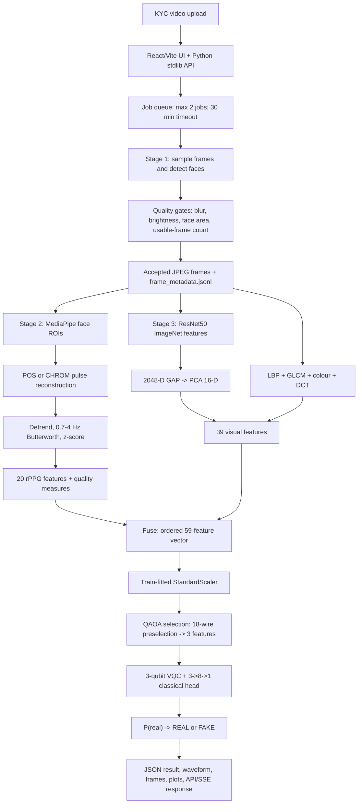

# Deepfake Detection in Low-Resolution KYC Videos Using rPPG and Hybrid Quantum Machine Learning

## Abstract

This report documents the implemented research prototype for detecting manipulated
KYC videos using remote photoplethysmography (rPPG), visual descriptors, and a
hybrid quantum-classical classifier. The implementation is an evidence-based
four-stage pipeline: frame sampling and face-quality filtering; physiological
signal extraction; visual feature extraction; and feature selection followed by a
hybrid variational quantum classifier (VQC). The codebase contains a fused
59-feature contract (20 rPPG and 39 visual features), a three-qubit VQC, a
QAOA-inspired selector, a classical-baseline evaluator, and a browser/API
application.

The results in the present artifact directory must not be interpreted as
full-dataset results. The local dataset contains 4,093 clips, but the persisted
training artifacts were produced by a 38-clip smoke run (20 fake and 18 real)
with an eight-clip test set. On that test set, the VQC artifact reports accuracy
0.500, F1 0.600, and ROC-AUC 0.5625. Gaussian Naive Bayes and XGBoost each
report accuracy 0.625 on the same split. These small-sample, artifact-read
values do not establish superiority of the quantum model or robustness to
low-resolution/compressed video. No controlled resolution/compression sweep,
component ablation, or reproducible latency benchmark is present. Accordingly,
this document is a structured academic draft and an audit of what can honestly
be submitted after supervisor review, not a claim of completed final-scale
validation.

**Keywords:** deepfake detection; KYC; remote photoplethysmography; rPPG;
ResNet50; hybrid quantum-classical machine learning; QAOA; variational quantum
classifier; DFDC; video forensics.

## 1. Introduction

### 1.1 Research context

Video-based KYC is vulnerable to face-swapping and related synthetic-media
attacks. The project investigates whether physiological evidence from facial
colour variation can complement appearance-based evidence. The implemented
system recovers rPPG signals from facial regions, combines them with ResNet50
and handcrafted visual descriptors, and sends the fused representation to a
quantum-classical decision layer.

### 1.2 Evidence and status convention

This report uses the following status labels:

* **Verified:** directly observed in source code, configuration, an artifact, or
  a repository record.
* **Partially verified:** some requested details are present, but the complete
  claim is not supported.
* **Artifact-read, not reproduced:** a value is transcribed from an existing
  generated artifact, but no fresh experiment was executed for this report.
* **Not available:** the inspected repository does not contain the evidence.
* **Required experimental validation:** a claim needs a new controlled experiment.

The implementation and the repository's prior read-only audit
(`PROJECT_RESEARCH_REPORT.md`) are treated as the primary evidence. Where
documentation conflicts with executable code, the implementation is described
as the current behavior and the discrepancy is recorded.

### 1.3 Traceability overview

| Requirement | Primary evidence | Status |
|---|---|---|
| 1 | `README.md`, `AGENTS.md`, `pyproject.toml`, `WORKING/quantum/config.py` | Verified |
| 2 | `architecture.mmd`, `WORKING/run_pipeline.py`, `frontend/server.py` | Verified |
| 3 | `WORKING/frame`, `WORKING/RPPG`, `WORKING/visual`, `WORKING/quantum` | Verified |
| 4 | `DFDC_Dataset/`, output manifests, `.env`, extraction logs | Partially verified |
| 5 | `WORKING/output/quantum/split_manifest_fused.json`, `quantum/data.py` | Verified for smoke run |
| 6 | frame/rPPG quality thresholds and comments | Partially verified |
| 7 | `visual/extractor.py`, rPPG modules, quantum modules | Partially verified; no ViT |
| 8 | `quantum/qaoa.py`, `qaoa_sim.py`, `vqc.py`, config/artifacts | Verified |
| 9 | `quantum/config.py`, `vqc.py`, `training_log.jsonl` | Verified for recorded run |
| 10 | `requirements.txt`, `pyproject.toml`, package metadata, current host inspection | Partially verified |
| 11 | `metrics_quantum.json`, plots, evaluation code | Artifact-read, not reproduced |
| 12 | output directory and repository-wide experiment search | Not available |
| 13 | `metrics_baselines.json`, evaluation code | Artifact-read, not reproduced |
| 14 | `quantum/config.py`, `selection_comparison_fused.json`, change log | Not available |
| 15 | timing instrumentation and server timeout constants | Unverified measurements |
| 16 | extraction logs, implementation, change log, documentation | Verified limitations |
| 17 | `.gitignore`, `.env`, server retention/validation code | Partially verified |
| 18 | `architecture.mmd`, PNG plots, `Docs/` figures | Partially verified |
| 19 | git remote, source tree, README commands | Verified locally; public visibility unverified |
| 20 | `README.md` team table and git history | Partially verified |

## 2. Research Objectives and Contributions

### 2.1 Final Project Title and Research Objective

The final research title used for this report is **“Deepfake Detection in
Low-Resolution KYC Videos Using rPPG and Hybrid Quantum Machine Learning.”**
The repository itself uses the shorter title “Deepfake Video Detection for KYC
(rPPG + Visual + Quantum ML).”

The implemented research problem is binary detection of real versus manipulated
KYC videos. The objectives supported by the implementation are:

1. recover physiological and appearance evidence from difficult video input;
2. preserve a reproducible 20+rPPG plus 39+visual fused feature contract;
3. select a small subset of fused features using a supervised QAOA cost;
4. classify the selected features with a hybrid quantum-classical model; and
5. expose the result through a local web/API workflow.

The motivation is that face-swap videos may preserve the source person's genuine
physiological signal, so rPPG alone is expected to be insufficient; visual and
physiological evidence are therefore combined. The research questions implied by
the implementation are:

* Can rPPG-derived features provide useful complementary evidence for DFDC-style
  face swaps?
* Does fused visual/rPPG representation support a compact quantum-classical
  classifier?
* Does QAOA selection identify a useful three-feature representation?
* Does the implementation demonstrate robustness to low-quality video?

Only the first three questions have partial artifact evidence. The last question
has no controlled robustness results.

### 2.2 Explicitly numbered requirement 1 — **Final Project Title and Research Objective**

**Evidence-based answer:** The title, problem, objectives, motivation, research
questions, and intended contributions are stated above. The intended
contribution is a working proof-of-concept pipeline, not a demonstrated quantum
advantage result. The repository does not contain a preregistered hypothesis,
power analysis, or final-scale experimental protocol.

## 3. System Architecture

### 3.1 Explicitly numbered requirement 2 — **Complete Architecture Diagram**

The following Mermaid flowchart is a reproducible summary of the implemented
architecture. It is derived from `architecture.mmd`, `README.md`,
`WORKING/run_pipeline.py`, and `frontend/server.py`.



The repository also contains the more detailed six-layer diagram in
`architecture.mmd`, including storage artifacts and external dataset inputs.

### 3.2 Explicitly numbered requirement 3 — **Detailed Preprocessing Steps**

1. **Video decoding and sampling:** OpenCV decodes the video. The end-to-end
   runner samples at 30 FPS; the standalone frame CLI defaults to 10 FPS.
2. **Face detection:** YOLOv8n-face is configured with confidence 0.25 and
   `imgsz=320`. Accepted face boxes are written as native-resolution JPEGs.
3. **Quality gates:** the frame stage uses variance-of-Laplacian blur threshold
   3.0, brightness limits 30--235, minimum face-area ratio 0.002, and a
   minimum sequence length of 32 frames. rPPG requires at least 24 usable frames,
   average face size at least 48x48 pixels, and non-degenerate colour variation.
4. **Face alignment/ROIs:** MediaPipe Face Landmarker supplies left-cheek,
   right-cheek, and forehead regions. A minimum ROI size is relaxed for
   low-resolution frames; no independent geometric face-alignment transform is
   documented.
5. **Physiological processing:** POS is the default method and CHROM is
   available. The signal chain interpolates missing values, detrends using
   Tarvainen detrending with lambda 300, applies a fourth-order (adaptively
   reduced for short signals) Butterworth band-pass from 0.7 to 4.0 Hz, and
   z-score normalizes the result. The analysis window is 8 seconds.
6. **Visual preprocessing:** accepted frames are sampled with a maximum of 100
   frames at an effective 10 FPS. ResNet50 crops are resized to 224x224 and
   ImageNet-normalized. Per-video deep features are averaged before the
   train-fitted PCA transform.
7. **Feature preparation:** the 20 rPPG features and 39 visual features are
   concatenated in the canonical order. Implausible heart rates outside
   30--220 BPM and non-finite records are filtered. A StandardScaler is fitted
   on training data only and reused at inference.
8. **Temporal windowing:** the rPPG window is explicitly 8 seconds; the project
   does not document a separate sliding-window aggregation protocol for final
   classification.

## 4. Materials and Methods

### 4.1 Explicitly numbered requirement 4 — **Dataset Names, Sources, Sizes, and Class Distribution**

| Dataset/material | Evidence and count | Status |
|---|---|---|
| Local DFDC copy | `DFDC_Dataset/`; 4,093 clips: 2,127 real and 1,966 fake; approximately 2.17 GB | Verified locally |
| Current feature-table subset | 38 clips after 40 attempts: 20 fake and 18 real; two failed extraction | Verified artifact |
| Root `test1.mp4` | One 19.4 MB video used as an available manual/inference input, not a dataset | Verified locally |
| Face Landmarker model | Bundled `WORKING/RPPG/face_landmarker.task` | Verified artifact |
| YOLO face weights | YOLOv8n/e/t weights present; referenced YOLOv8x weight is absent | Partially verified |

The class convention is `1=fake, 0=real` in the rPPG CSV and
`LABEL_REAL=1, LABEL_FAKE=0` in the quantum layer; conversion is confined to
`quantum.data.csv_to_quantum_label()`.

The repository does not contain the official upstream DFDC manifest, provenance
record, license text, source-part mapping, or a verified access URL. Therefore
the upstream source URL, consent/provenance history, uniqueness of all 4,093
clips, and official source distribution are **[NOT AVAILABLE IN THE PROJECT]**.
Those details require the official dataset terms and download record to be
supplied by the project team.

### 4.2 Explicitly numbered requirement 5 — **Training, Validation, and Testing Split**

The persisted smoke-run split uses seed 42, validation ratio 0.20, and test
ratio 0.20. The split is metadata-aware and clip-grouped. Candidate grouping
fields include subject, identity, original/source video, group, and several
SHA-256 fields; when no correlation metadata exists, the implementation falls
back to a clip-path group.

| Split | Clips | Fake | Real |
|---|---:|---:|---:|
| Train | 22 | 12 | 10 |
| Validation | 8 | 4 | 4 |
| Test | 8 | 4 | 4 |
| **Total** | **38** | **20** | **18** |

Five-fold stratified cross-validation is also recorded. The grouping design is
intended to prevent related clips crossing boundaries, but the artifact does not
prove that every DFDC identity relationship is known. Full-dataset leakage
verification and duplicate analysis remain **[REQUIRES EXPERIMENTAL
VALIDATION]**.

### 4.3 Explicitly numbered requirement 6 — **Low-Resolution and Compression Settings**

Implemented defensive settings include detector input size 320, detection
confidence 0.25, blur threshold 3.0, relaxed rPPG blur threshold 3.0, minimum
ROI size reduction from 10 to 3 pixels, wider skin ranges, disabled skin mask
under low-resolution conditions, and adaptive filter-order handling. Accepted
frames are stored at native resolution with default OpenCV JPEG encoding; no
controlled resize, codec, bitrate, CRF, or quality-factor sweep is implemented.

Consequently, actual input resolution distributions, codecs, bitrates, frame
rates, and noise/degradation configurations for a robustness experiment are
**[NOT AVAILABLE IN THE PROJECT]**. The settings above are implementation
defenses, not evidence of measured robustness.

### 4.4 Explicitly numbered requirement 7 — **CNN, ViT, rPPG, and Quantum Module Details**

* **CNN:** ImageNet-pretrained ResNet50, 2048-dimensional global-average-pooled
  feature vector, reduced by PCA to 16 dimensions.
* **Handcrafted visual branch:** 10 uniform-LBP bins, four GLCM descriptors, six
  RGB mean/std descriptors, and three DCT-frequency descriptors: 23 dimensions.
* **ViT:** no ViT, `timm`, or Vision Transformer implementation exists in the
  inspected source tree. This requested component is **[NOT AVAILABLE IN THE
  PROJECT]**, not an implemented result.
* **rPPG:** three MediaPipe ROIs, POS/CHROM reconstruction, filtering and
  detrending, and a 20-feature physiological vector.
* **Fusion:** concatenation of the ordered 20 rPPG and 39 visual features,
  followed by train-only scaling.
* **Quantum-classical model:** QAOA selects three features and the VQC produces
  three quantum expectation values for a small classical head.

The side RandomForest rPPG classifier is a cross-check artifact, not the owner
of the final verdict.

### 4.5 Explicitly numbered requirement 8 — **Quantum Circuit Configuration**

The implementation provides two related circuits:

**QAOA selector.** For a 59-feature input, supervised classical AUC
preselection reduces the search to 18 features so state-vector simulation is
tractable. The diagonal cost Hamiltonian uses
`2|AUC-0.5|` discrimination weights, redundancy penalty 0.3, cardinality
penalty 0.5, target cardinality three, depth `p=3`, eight restarts, seed 42,
COBYLA, and at most 500 iterations. The torch-native simulator uses
complex128 state vectors and an X mixer implemented as `Rx(2 beta)`. The
persisted selection is `[7, 34, 22]`, corresponding to
`left_right_cheek_correlation`, `deep_feat_14`, and `deep_feat_2`; its recorded
selection stability mean Jaccard score is 1.0.

**VQC.** The decision circuit has three qubits, Y-angle embedding, three
strongly entangling layers, and a Pauli-Z expectation measurement on each
qubit. The outputs enter a `Linear(3,8)`, ReLU, dropout-0.2, and scalar output
head interpreted as `P(real)`. The default path is an exact torch-native
complex128 state-vector simulator; a PennyLane path is retained for
cross-verification. Weights are initialized as `0.1 * randn`.

Reproducible circuit representation:

```text
for each input x in R^3:
    for q in {0,1,2}: apply RY(x[q]) on q
    repeat l = 1..3:
        apply the StronglyEntanglingLayers single-qubit rotations
        apply the configured circular entangling CNOT/SWAP pattern
    measure <Z_0>, <Z_1>, <Z_2>
    h = ReLU(W1 * measurements + b1)
    h = Dropout_0.2(h)
    p_real = sigmoid(W2 * h + b2)
```

No hardware execution is present. The three-qubit configuration is a
proof-of-concept circuit; the repository does not establish quantum advantage.

## 5. Dataset and Experimental Protocol

### 5.1 Explicitly numbered requirement 9 — **Training Configuration**

| Setting | Recorded value |
|---|---|
| Optimizer | AdamW |
| Base learning rate | 0.05 |
| Schedule | cosine warmup; 3 warmup epochs |
| Weight decay | 0.01 |
| Batch size | 256 |
| Maximum epochs | 80 |
| Actual epochs in log | 47 |
| Loss | class-balanced focal loss, alpha 0.45, gamma 1.0 |
| Label smoothing | 0.03 |
| Gradient clipping | 1.0 |
| Early stopping | patience 12; min delta 1e-4; restore best validation loss |
| Seed | 42 |
| Best checkpoint | epoch 34; best validation loss recorded as 0.1231 |
| Evaluation threshold | Youden threshold 0.506755530834198 |

The checkpoint and epoch snapshots are present in the generated output tree.
Live inference constructs a default 0.5 decision configuration after loading the
stored threshold, so evaluation and deployment thresholds are inconsistent.
This is a material reproducibility defect requiring correction before final
deployment claims.

### 5.2 Explicitly numbered requirement 10 — **Hardware and Software Environment**

| Component | Evidence-based value |
|---|---|
| Operating system | Windows 11 Home Single Language, build 10.0.26200 |
| CPU | Intel Core i5-13450HX, 10 cores / 16 logical processors |
| RAM | approximately 23.7 GB observed on the audit host |
| GPU | NVIDIA GeForce RTX 4050 Laptop GPU; current-host observation |
| Python | 3.11.9 virtual environment |
| PyTorch | 2.5.1+cu121 |
| torchvision / torchaudio | 0.20.1+cu121 / 2.5.1+cu121 |
| PennyLane / lightning | 0.44.1 / 0.44.1 |
| Ultralytics | 8.3.0 |
| MediaPipe | 1.0.1 |
| NumPy / SciPy / scikit-learn | 1.26.4 / 1.17.1 / 1.9.0 |
| XGBoost / pandas / matplotlib | 3.2.0 / 3.0.5 / 3.11.1 |
| CUDA | 12.1 as encoded by the PyTorch package suffix |

The hardware table describes the current audit host; the training artifacts do
not store a host snapshot, GPU utilization, CUDA availability result, driver
record, or RAM-at-training measurement. These fields are therefore **[PARTIALLY
VERIFIED]**.

## 6. Implementation and Training Configuration

### 6.1 Reproducibility-relevant implementation details

The source-of-truth feature schema is `FUSED_FEATURE_NAMES` in
`WORKING/quantum/config.py`; inference checks incoming feature names and order,
loads the train-fitted scaler, loads QAOA indices, verifies checkpoint schema,
and evaluates the VQC. The project supports fused mode only. Generated output
is controlled by `MAJ_OUTPUT_ROOT`; local configuration uses
`DFDC_DATASET_PATH` and `ALLOWED_ORIGINS`.

## 7. Experimental Results and Analysis

### 7.1 Explicitly numbered requirement 11 — **Evaluation Metrics and Results**

All values below are read from `metrics_quantum.json` for the eight-clip test
split and were not freshly reproduced for this report.

| Metric | VQC test value |
|---|---:|
| Accuracy | 0.500 |
| Precision | 0.500 |
| Recall / sensitivity | 0.750 |
| Specificity (fake recall as stored) | 0.250 |
| Balanced accuracy | 0.500 |
| F1-score | 0.600 |
| ROC-AUC | 0.5625 |
| PR-AUC | 0.6679 |
| Brier score | 0.2465 |
| Expected calibration error | 0.1881 |
| False-acceptance rate | 0.750 |
| False-rejection rate | 0.250 |

The stored confusion matrix uses rows=true and columns=predicted:

|  | Predicted REAL | Predicted FAKE |
|---|---:|---:|
| True REAL | 1 | 3 |
| True FAKE | 1 | 3 |

The five-fold cross-validation summary reports accuracy
`0.700 +/- 0.197`, ROC-AUC `0.700 +/- 0.267`, balanced accuracy
`0.667 +/- 0.230`, and F1 `0.467 +/- 0.400`. No confidence intervals are
provided. With `n=8`, these estimates are unstable and should not be presented
as final generalization performance.

Metric definitions follow standard binary conventions: accuracy is the
proportion correct; precision is positive predictive value; recall is true
positive rate; F1 is the harmonic mean of precision and recall; ROC-AUC is the
threshold-independent area under the receiver-operating curve; and balanced
accuracy averages class recalls. The report retains the artifact's real/fake
orientation and does not silently relabel it.

### 7.2 Explicitly numbered requirement 12 — **Low-Resolution and Compressed-Video Results**

No quantitative result is available for a resolution, codec, bitrate, CRF, JPEG
quality, frame-rate, or noise condition. No degradation harness or stratified
robustness artifact exists. The low-resolution claim is therefore
**[REQUIRES EXPERIMENTAL VALIDATION]**. A valid follow-up must freeze the split,
define a resolution/quality ladder, re-encode only the held-out inputs, and
report the same metrics and test counts per condition.

## 8. Baseline and Ablation Studies

### 8.1 Explicitly numbered requirement 13 — **Baseline Model Results**

The following baselines were evaluated on the same eight-clip smoke-run test
split. Values are artifact-read and not independently reproduced.

| Model | Accuracy | Balanced acc. | Precision | Recall | F1 | ROC-AUC |
|---|---:|---:|---:|---:|---:|---:|
| RandomForest | 0.500 | 0.500 | 0.500 | 0.750 | 0.600 | 0.500 |
| MLP | 0.375 | 0.375 | 0.400 | 0.500 | 0.444 | 0.5625 |
| Logistic Regression | 0.500 | 0.500 | 0.500 | 0.750 | 0.600 | 0.750 |
| Calibrated LinearSVC | 0.500 | 0.500 | 0.500 | 0.750 | 0.600 | 0.750 |
| GaussianNB | 0.625 | 0.625 | 0.600 | 0.750 | 0.667 | 0.750 |
| XGBoost | 0.625 | 0.625 | 0.667 | 0.500 | 0.571 | 0.656 |
| VQC | 0.500 | 0.500 | 0.500 | 0.750 | 0.600 | 0.5625 |

The recorded five-fold CV means are also available in
`metrics_baselines.json` (for example, RandomForest accuracy/AUC
`0.700/0.933`, MLP `0.740/0.933`, and Logistic Regression `0.750/0.867`).
The divergence between CV and the eight-clip test split demonstrates variance,
not superiority. The evidence does not support a claim that the VQC outperforms
classical baselines.

### 8.2 Explicitly numbered requirement 14 — **Ablation-Study Results**

No component ablation results are present. The only supported feature set is
`fused`; `PHASE6_FEATURE_SETS` and `PHASE7_ABLATION_SETS` are empty, and the
former sweep machinery was retired. The selection comparison reports identical
QAOA and classical top-three features (3/3 overlap), but this is not an ablation
of rPPG, visual features, fusion, or classifier choice.

The following comparisons are therefore **[NOT AVAILABLE IN THE PROJECT]**:
rPPG-only versus visual-only; fused versus either branch; ResNet50 versus a
different visual backbone; all 59 features versus three selected features; and
VQC versus a matched classical model under a full-scale protocol.

## 9. Computational Performance

### 9.1 Explicitly numbered requirement 15 — **Inference Time and Computational Requirements**

The end-to-end runner records a `duration_sec` field using
`time.perf_counter()`, and the API imposes a 30-minute job timeout with at most
two concurrent jobs. However, no completed timing JSON, per-stage latency
breakdown, throughput, model parameter count, memory measurement, warm-up
protocol, or hardware-timed benchmark is present in the inspected artifacts.
The simulator documentation contains micro-performance claims, but they are
not measurements reproducibly linked to the current run.

Thus preprocessing latency, VQC latency, throughput, memory consumption, model
size, and batch timing are **[NOT AVAILABLE IN THE PROJECT]**. A reproducible
benchmark must specify the host, CPU/GPU, input duration and dimensions, warm-up
count, repetitions, synchronization policy, and whether model loading is
included.

## 10. Limitations and Failure Analysis

### 10.1 Explicitly numbered requirement 16 — **Failure Cases and Known Limitations**

**Observed or artifact-supported limitations**

1. Only 38 of 4,093 local clips contributed to the current artifacts (0.93%);
   the test set has eight clips.
2. Two of 40 attempted clips failed feature extraction:
   `pcemgkfqgn.mp4` and `bfdopzvxbi.mp4`.
3. Documentation and code disagree about inconclusive handling. Older
   documentation describes an `INCONCLUSIVE`/exit-3 path, while a change-log
   entry records removal of uncertain outcomes and defaulting extraction failure
   to `FAKE` with confidence 0.0. This can turn a technical failure into a
   fraud accusation.
4. Evaluation uses threshold 0.5067555 while live decision construction uses
   0.5.
5. The rPPG branch is vulnerable to occlusion, motion, very short clips, small
   faces, and poor perfusion; it requires a visible face and at least 24 usable
   frames.
6. The QAOA-selected features match the classical top-three selection, so no
   incremental selection benefit is demonstrated.
7. Only three qubits are used; this is not evidence of scalable quantum
   advantage.
8. A referenced YOLOv8x-face weight is missing, a stale docstring says “24
   features” although the implemented rPPG vector has 20, and a referenced
   `Docs/charts/` directory is absent.
9. The rPPG RandomForest pickle is an untrusted serialized artifact and requires
   controlled loading.

**Anticipated but unmeasured risks**

* domain shift across cameras, demographics, lighting, codecs, and capture
  devices;
* bias from a dataset whose provenance and demographic metadata are not recorded;
* adversarial manipulation of physiological or visual cues; and
* operational risk from using a binary automated decision in high-stakes KYC.

## 11. Ethical, Privacy, and Responsible-Use Considerations

### 11.1 Explicitly numbered requirement 17 — **Dataset and Ethical/Privacy Considerations**

The repository contains no local dataset license, provenance manifest, consent
record, data-processing agreement, or ethics approval. The official DFDC terms
and the provenance of the two-folder local copy must therefore be confirmed
before redistribution or university submission. No claim of ethical approval,
consent, or legal compliance is made here.

The system processes faces and derives a blood-volume pulse signal, which is
biometric-adjacent and health-related personal information. In KYC, false
acceptance can enable fraud while false rejection can deny access or wrongly
escalate a customer. The current failure-to-FAKE behavior described above is
particularly important. A responsible deployment should require human review,
calibrated abstention, documented appeal procedures, demographic performance
audits, retention limits, access control, encryption, and a threat model.

The API implements useful controls: 200 MB upload validation, magic-byte checks,
localhost CORS policy, traversal-protected artifact paths, a two-job concurrency
cap, a 30-minute timeout, one-hour job TTL, and 24-hour frame-sequence cleanup.
These controls do not establish regulatory compliance or eliminate biometric
privacy risk.

## 12. Discussion

The implementation successfully connects physiological, visual, and
quantum-classical components into a reproducible software pipeline. Its strongest
engineering contributions are the fixed feature schema, train-only scaling,
persisted split/selection/checkpoint artifacts, Hamiltonian consistency check,
and API-level safeguards. The current empirical evidence is much narrower than
the research title suggests. rPPG documentation itself reports near-chance
historical discrimination (AUC approximately 0.47--0.53), which is consistent
with face swaps retaining genuine source-person physiology. The smoke-run
metrics likewise show no reliable advantage for the VQC over matched classical
baselines.

The results should therefore be framed as a feasibility prototype. A defensible
research conclusion requires full-dataset training, identity/duplicate
verification, pre-registered degradation conditions, complete ablations,
confidence intervals, calibrated failure handling, and a recorded benchmark
environment. The current artifacts are valuable for reproducibility engineering
but insufficient for a claim of robustness or quantum advantage.

## 13. Conclusion and Future Work

### 13.1 Research conclusion

The project implements a four-stage fused deepfake detector with POS/CHROM
rPPG, ResNet50 plus handcrafted features, QAOA-based feature selection, and a
three-qubit hybrid VQC. The available smoke-run artifact reports chance-level
accuracy (0.500) and ROC-AUC 0.5625 on eight test clips. It does not establish
that the proposed approach is superior to classical alternatives, robust to
low-resolution or compression, or ready for autonomous KYC decisions.

### 13.2 Required future work

1. Rebuild features over all verified clips and document excluded samples.
2. Confirm DFDC provenance, licensing, identity metadata, and duplicate policy.
3. Freeze a leakage-tested split and report confidence intervals.
4. Add controlled resolution, codec, bitrate, frame-rate, and noise experiments.
5. Restore a principled abstention/human-review path and unify thresholds.
6. Run rPPG-only, visual-only, fused, selection, and classifier ablations.
7. Record per-stage latency, memory, parameters, and full host metadata.
8. Add a ViT only if it is a genuine research requirement, then train and
   evaluate it under the same protocol.
9. Audit demographic fairness, privacy, security, and operational safeguards.

## 14. Reproducibility and Code Availability

### 14.1 Explicitly numbered requirement 18 — **Architecture Figures, Graphs, and Tables**

Verified figures and tables available in the project include:

* `architecture.mmd`: six-layer Mermaid architecture diagram.
* `WORKING/output/quantum/roc_curve.png`: ROC plot generated by evaluation code.
* `WORKING/output/quantum/confusion_matrix.png`: confusion matrix plot.
* `WORKING/output/quantum/calibration_curve.png`: calibration plot.
* `Docs/maj_proj_report_sem_6/images/`: semester-report architecture, class,
  activity, use-case, ER, and workflow figures.
* JSON/CSV-backed tables: split manifest, training log, quantum metrics,
  baseline metrics, and selection comparison.

The referenced `Docs/charts/` directory is absent, so no additional performance
charts are claimed. All numerical tables in this report are transcriptions of
verified artifacts; no synthetic graph or estimated result was generated.

### 14.2 Explicitly numbered requirement 19 — **GitHub Link or Project Code**

The verified local git remote is:
`https://github.com/NYN-05/Major_project.git`.

The repository structure is:

```text
WORKING/frame/       frame sampling, YOLO face detection, quality gates
WORKING/RPPG/        MediaPipe ROIs, POS/CHROM, physiological features
WORKING/visual/      ResNet50, PCA, handcrafted visual features, fusion
WORKING/quantum/     data, scaling, QAOA, VQC, evaluation and inference
WORKING/run_pipeline.py
frontend/            React/Vite client and Python standard-library API
Scrape/              development-only probes and artifacts
```

Setup and execution commands, from the repository instructions, are:

```powershell
pip install -r requirements.txt
cd WORKING
python -m quantum.tests
python -m quantum.pipeline --all
python run_pipeline.py --source path\to\video.mp4 --method POS --out result.json
cd ..\frontend
npm install
npm run build
python server.py
```

The dataset, trained models, CSVs, and videos are intentionally excluded from
version control. The local source is available, but the remote repository's
public/private visibility was not checked in this audit. Public availability is
therefore **[REQUIRES CONFIRMATION]**.

## 15. Individual Contributions and Authorship

### 15.1 Explicitly numbered requirement 20 — **Confirmation of Individual Contributions and Authorship**

The README declares the following division of work:

| Contributor | Declared contribution | Verification status |
|---|---|---|
| Jhashank | rPPG-to-classifier pipeline and quantum model (Stage 3) | README declaration only |
| Sumit | input-to-ROI pipeline: data, frames, and face detection (Stage 1) | README declaration only |
| Aswin | preprocessing policy, evaluation, and integration (Stage 2) | README declaration only |
| Additional authors | [AUTHOR CONFIRMATION REQUIRED] | Not documented |

The local git history has 140 commits attributed to the single identity
`NYN-05 <jnyn2005@gmail.com>`. This does not prove that only one person worked
on the project, nor does it independently verify the README contribution
table. The contribution checklist PDF and semester-report PDFs are present but
were not machine-verified during this audit. Final authorship, ordering,
individual contribution statements, supervision, and conflict-of-interest
declarations require explicit team confirmation.

## References

[1] NYN-05, “Major_project,” GitHub repository, verified local remote:
https://github.com/NYN-05/Major_project.git.

[2] NYN-05, `README.md`, repository documentation, local project copy.

[3] NYN-05, `AGENTS.md`, repository implementation and reproducibility guide,
local project copy.

[4] NYN-05, `PROJECT_RESEARCH_REPORT.md`, read-only evidence audit dated
2026-10-11, local project copy.

[5] NYN-05, `WORKING/quantum/metrics_quantum.json`, generated evaluation
artifact, smoke run dated 2026-10-11.

[6] NYN-05, `WORKING/output/quantum/metrics_baselines.json`, generated baseline
evaluation artifact, smoke run dated 2026-10-11.

[7] NYN-05, `WORKING/output/quantum/training_log.jsonl`,
training-history artifact, smoke run dated 2026-10-11.

[8] NYN-05, `WORKING/output/quantum/split_manifest_fused.json`, persisted
grouped split manifest, smoke run dated 2026-10-11.

[9] NYN-05, `architecture.mmd`, Mermaid architecture source, local project copy.

## Appendix A. Evidence-to-claim checklist

| Claim class | Evidence used | Fresh verification in this report |
|---|---|---|
| Architecture and preprocessing | source modules, `architecture.mmd`, README | read-only trace; no source changes |
| Dataset counts | local directory counts and checkpoint/extraction log | artifact audit; no retraining |
| Splits | persisted split manifest and `quantum/data.py` | manifest inspection |
| Hyperparameters | `quantum/config.py`, VQC source, training log | configuration/log inspection |
| Metrics | metrics JSON and generated plots | transcribed; not reproduced |
| Robustness | repository-wide absence of sweep artifacts | absence documented; no experiment |
| Ablation | empty feature-set configuration and change history | absence documented |
| Timing | timing instrumentation and server constants | no benchmark executed |
| Ethics/privacy | `.gitignore`, `.env`, API controls, missing license evidence | implementation inspection |
| Authorship | README declaration and git shortlog | declaration separated from verification |

## Appendix B. Submission readiness

The report is structurally complete for all 20 requested requirements, but the
following items must be resolved before presenting it as a final results paper:
full-dataset metrics; controlled low-resolution/compression results; ablations;
latency and memory benchmarks; dataset license/provenance; threshold and
inconclusive-path reconciliation; remote visibility; and signed author
contribution confirmation.
